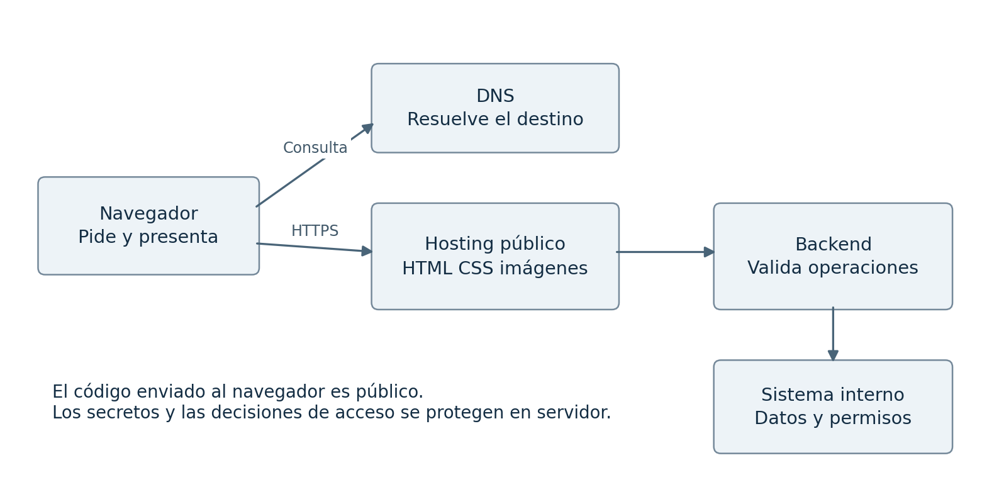
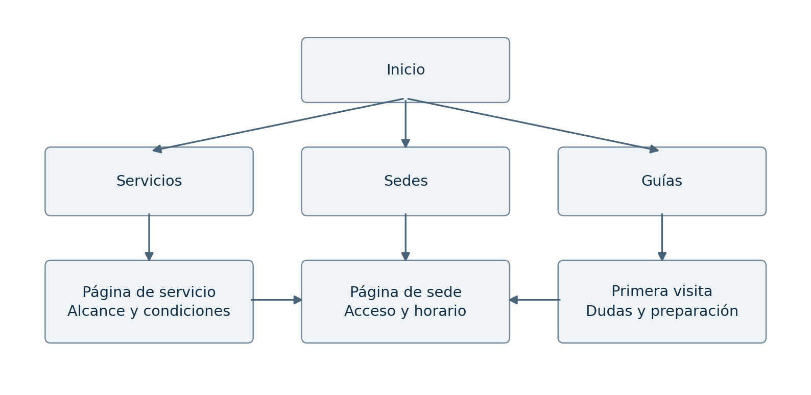
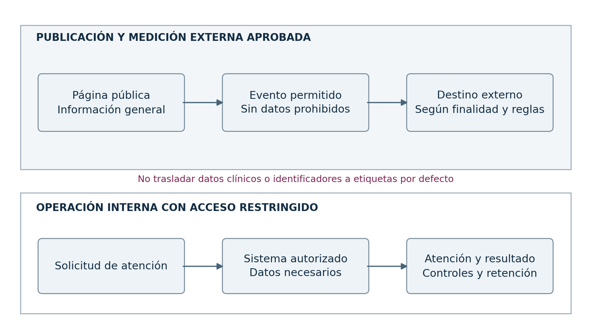
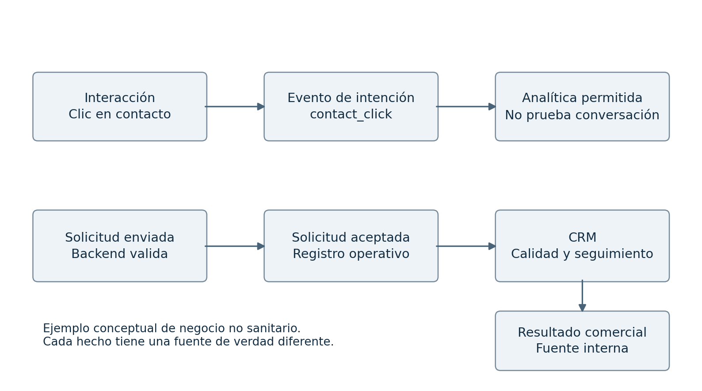

# SEO GEO y Tracking para construir sitios web en 2027

Guía práctica de cero a nivel avanzado

Construcción web · Búsqueda · Respuestas de IA · Analítica · Conversión

Edición preparada en octubre de 2026 para estudiar y aplicar durante 2027

## Qué aprenderás y qué construirás

Este libro te enseña a convertir una idea en un sitio web que las personas puedan encontrar, comprender y utilizar. También aprenderás a medir lo que ocurre después de una visita: consultas, oportunidades, citas, compras y resultados comerciales. Comenzamos sin dar por hecho que conoces palabras como dominio, servidor, SEO o evento. Terminamos con decisiones de arquitectura, diagnóstico técnico, seguimiento entre sistemas y experimentación.

El resultado de estudio será un proyecto verificable. Tendrás un documento de objetivos, una estructura de páginas, contenidos revisados, reglas de indexación, una propuesta de medición, pruebas de privacidad y un plan de mejora. Saber explicar estas decisiones y comprobarlas en un proyecto real vale más que memorizar herramientas.

La progresión llega a un nivel avanzado de criterio y aplicación. La experiencia experta exige además proyectos, errores corregidos y actualización constante. Ningún libro puede garantizar una primera posición, una cita en una IA ni una venta. Sí puede darte un método para trabajar con evidencia y reconocer cuándo necesitas ayuda especializada.

## Cómo leer una edición para 2027

El corte documental de esta edición es octubre de 2026. El año 2027 identifica el período de aplicación; no significa que conozcamos cambios que todavía no se han anunciado. Las funciones, políticas, precios, interfaces y disponibilidad por país pueden cambiar. Por eso encontrarás tres formas de hablar del futuro.

Un fundamento estable explica cómo funciona algo: una página necesita ser accesible para que un robot pueda leerla. Una condición documentada describe lo publicado por una plataforma al preparar el libro. Una hipótesis de trabajo propone algo que conviene probar: una tabla comparativa puede facilitar una respuesta precisa. Una hipótesis no se convierte en regla porque alguien la llame GEO.

Antes de un lanzamiento en 2027, revisa las fuentes de los capítulos que afecten privacidad, publicidad, robots y funciones de buscadores. Comprueba el comportamiento en tu propia cuenta. La última parte incluye una rutina para mantener el manual operativo sin depender de capturas de pantalla que envejecen.

## Los casos y los números

Usaremos tres clases de ejemplos. Los casos públicos documentados, como Rakuten 24 y la cuenta de demostración de Google Analytics, tienen referencias al final del libro. El caso aplicado de Insalud parte de un negocio odontológico con cuatro sedes en el sur de Quito; su arquitectura, textos y procesos web aquí son propuestas didácticas, no una auditoría del sitio actual. Los casos de la tienda de guitarras son ficticios.

Todas las cifras de tráfico, inversión, leads, ventas y conversiones de los ejercicios son simuladas, salvo cuando una cifra se atribuya expresamente a un caso público. No representan resultados reales de Insalud. Las direcciones con el dominio example son reservadas para enseñar: no son sitios operativos ni direcciones que debas registrar. Los nombres de eventos y fragmentos de código son ejemplos educativos; requieren adaptación y pruebas antes de publicarse.

No trabajaremos con historias clínicas ni datos reales de pacientes. En un negocio de salud, cambiar el nombre de un evento no vuelve seguro su contenido. La página visitada, un identificador y el contexto pueden revelar información sensible. El capítulo de privacidad determina qué se puede medir y hacia dónde.

## Tu mesa de trabajo

Necesitas una computadora, un navegador actualizado, un editor de texto y una carpeta para reunir evidencias. Un teléfono servirá para probar la experiencia móvil. Los primeros ejercicios se resuelven sin pagar herramientas ni comprar un dominio. Para publicar necesitarás un hosting o plataforma, acceso al DNS y un responsable de las cuentas.

Una carpeta útil contiene objetivos, inventario de páginas, contenidos, medición, pruebas y cambios. Escribe la fecha de cada comprobación. No guardes contraseñas o tokens en esa carpeta; usa un gestor de contraseñas y permisos individuales.

Cuando aparezca una herramienta nueva, leerás para qué sirve antes de configurarla. Search Console observa la presencia de un sitio en Google. Analytics registra interacciones permitidas. Tag Manager organiza etiquetas. Un CRM administra oportunidades comerciales. Ninguna de estas piezas reemplaza a las otras.

## Ruta de aprendizaje

| Etapa | Capítulos | Lo que deberías poder demostrar |
| --- | --- | --- |
| Fundamentos | 1 a 6 | Explicar el sistema web y diseñar una experiencia útil |
| Construcción responsable | 7 a 11 | Revisar una página, publicarla y proteger datos |
| SEO | 12 a 20 | Investigar demanda y diagnosticar visibilidad |
| GEO | 21 a 23 | Preparar información y observar su uso en IA |
| Tracking | 24 a 29 | Diseñar, validar e interpretar medición |
| Mejora y operación | 30 a 32 | Experimentar, lanzar y mantener el proyecto |
| Práctica integrada | Laboratorios y proyecto final | Defender una implementación con evidencias |

Puedes estudiar en doce semanas, dedicando sesiones regulares a leer, hacer y revisar. Si tienes menos tiempo, reduce el tamaño del proyecto, no elimines las pruebas. Una web de cinco páginas bien verificada enseña más que cincuenta páginas cuyo formulario no funciona.

Cada capítulo propone un ejercicio y una respuesta orientativa. Los laboratorios del final reúnen tareas completas con criterios de aprobación. Las soluciones explican el razonamiento; puede haber otras respuestas válidas si respetan las restricciones y aportan evidencia.

## Convenciones del libro

SEO significa optimización para motores de búsqueda. GEO se usa aquí como Generative Engine Optimization, es decir, trabajo para que una información pueda ser encontrada, comprendida y, cuando corresponda, citada por sistemas de respuesta generativa. SEO local es el trabajo ligado a ubicaciones físicas; no confundiremos ambos significados de geo.

Tracking significa seguimiento de interacciones. En este libro siempre implica una finalidad definida, datos mínimos, controles de privacidad y pruebas. Medir más no equivale a entender mejor.

Las referencias entre corchetes, como [R15], remiten a la bibliografía enlazada. Son lecturas para verificar conceptos y decisiones, no promesas de que una plataforma funcionará igual para siempre. El texto, los ejercicios, las plantillas y las propuestas de implementación están redactados para esta guía.


# Parte 1 Entender el sistema antes de construirlo

# Capítulo 1 Qué hace realmente un sitio web

## De una dirección a una experiencia

Imagina que alguien busca una clínica cerca de su casa. Ve un resultado, entra desde su teléfono, comprueba la ubicación y solicita una cita. Desde fuera parece una sola acción. En realidad depende de varias piezas: el sitio tiene que estar disponible, la página debe explicar lo que ofrece y el contacto debe llegar a una persona que pueda responder.

Un website o sitio web es un conjunto de páginas y recursos relacionados. Una página es una unidad concreta, identificada por una dirección o URL. La portada no es todo el sitio, igual que la recepción no es toda una clínica. Puede haber páginas de servicios, sedes, artículos, productos y contacto. Una landing page es una página diseñada alrededor de una tarea o campaña específica; no es sinónimo de portada.

El navegador es el programa que abre páginas: Chrome, Firefox o Safari son ejemplos. Internet es la red que conecta equipos. La web es uno de los servicios que utiliza esa red. WhatsApp, el correo y una web pueden participar del mismo recorrido, pero no registran automáticamente todo lo que sucede entre ellos.

## Cuatro preguntas que ordenan el proyecto

La primera pregunta es a quién ayudas. Una madre que busca atención infantil necesita información distinta a la de una persona que compara una prótesis. La segunda es qué necesita resolver. La tercera, qué acción puede realizar ahora. La cuarta, cómo comprobarás si esa acción produjo un resultado útil.

Una web puede vender directamente, generar consultas, ofrecer soporte o enseñar. Si no eliges una tarea principal por página, terminarás añadiendo botones por intuición. Un botón de WhatsApp no compensa una dirección confusa ni un tratamiento mal explicado.

Piensa en una cadena: descubrimiento, comprensión, confianza, acción y atención. SEO trabaja sobre la búsqueda y la comprensión de contenidos. GEO estudia la participación de esa información en respuestas de IA. La experiencia de usuario reduce dificultades. El tracking permite observar partes del recorrido. La operación comercial atiende la oportunidad. El resultado depende del conjunto.

## Un caso trabajado

Propuesta didáctica para Insalud: la página de una sede responde dónde está, cómo llegar, qué atención ofrece y cómo solicitar contacto. Una persona no debería entrar a un formulario general para descubrir después que eligió otra sede.

Supongamos que durante un período llegan 1.000 sesiones. Una sesión agrupa actividad de una visita según reglas de la herramienta; no equivale necesariamente a una persona distinta. Cien sesiones incluyen un clic de contacto y cuarenta producen solicitudes válidas. De ellas, veinte terminan en citas confirmadas. Son datos simulados.

Hay tres cantidades diferentes: cien clics, cuarenta solicitudes y veinte citas. Llamar a todo conversión ocultaría dónde ocurre la pérdida. Antes de mejorar la página debemos preguntar si falla el formulario, si el botón abre una app o si la respuesta humana llega tarde.

## Qué no demuestra una cifra

Tener muchas visitas no demuestra rentabilidad. Un visitante puede estar investigando o buscando empleo. Una posición promedio de Google tampoco describe todas las búsquedas: cambian el lugar, el dispositivo y la consulta. Una respuesta de IA que menciona una marca puede no incluir un enlace ni producir visitas.

El método comienza por definiciones. Una solicitud válida es un contacto utilizable que realmente pide información sobre la oferta. Una cita confirmada tiene registro y confirmación en el sistema operativo. Una venta necesita un criterio contable. Puedes cambiar estas definiciones para otro negocio, pero debes escribirlas antes de comparar informes.

## Ejercicio 1 Explicar tu proyecto sin jerga

Escribe un párrafo de cinco frases: quién visita tu sitio, qué necesita, qué página lo ayuda, qué acción realizará y qué resultado confirmará el negocio. Después identifica una cosa que no podrás observar solo desde el navegador.

Respuesta orientativa: una persona del sur de Quito busca una sede cercana; la página de ubicación explica acceso y servicios; solicita contacto; un asesor confirma la cita en el CRM; la asistencia se comprueba en el sistema de atención. El navegador puede observar un clic, pero no confirmar por sí solo la asistencia física.

La comprobación es sencilla: alguien ajeno al proyecto debería entender para qué existe tu sitio después de leer ese párrafo. Si necesita conocer tus herramientas para comprenderlo, vuelve a redactarlo.

Lectura de apoyo: funcionamiento de la búsqueda y fundamentos de SEO [R01, R02].

# Capítulo 2 Dominio hosting DNS y HTTPS

## Las piezas que hacen que una dirección abra

Un dominio es un nombre legible, como negocio.example. El registrador administra su contratación. El hosting proporciona los recursos que sirven el sitio. El DNS relaciona nombres con destinos y otros registros. No son la misma compra ni el mismo acceso. Una agencia puede gestionar las tres piezas, pero la empresa debería conservar la titularidad y la posibilidad de cambiarlas.

Una URL tiene varias partes. En https://negocio.example/sedes/villaflora/?origen=mapa, https es el esquema, negocio.example es el host, /sedes/villaflora/ es la ruta y origen=mapa es un parámetro de consulta. Un fragmento como #ubicacion señala una sección y normalmente no se envía al servidor en la petición HTTP. Saber leer una dirección ayuda a detectar duplicados y fugas de información.

Cuando abres una página, el navegador consulta cómo llegar al servidor, establece la conexión y pide un recurso. El servidor responde con un código de estado y contenido. El navegador interpreta HTML, aplica estilos y ejecuta el JavaScript permitido. Puede pedir imágenes y otros archivos adicionales.

## Los registros que encontrarás

| Registro | Función habitual | Error que debes evitar |
| --- | --- | --- |
| A | Apuntar un nombre a una dirección IPv4 | Copiar una IP antigua |
| AAAA | Apuntar a una dirección IPv6 | Mantener una ruta IPv6 rota |
| CNAME | Relacionar un nombre con otro nombre | Cambiarlo sin seguir al proveedor |
| MX | Indicar el destino del correo | Borrarlo al mover la web |
| TXT | Verificación y políticas diversas | Sustituir verificaciones sin inventario |

Las configuraciones del dominio raíz y los alias dependen del proveedor; algunos ofrecen registros equivalentes a CNAME para el raíz. No improvises una receta universal. Sigue la documentación del hosting y conserva los registros ajenos a la web, especialmente los del correo.

El TTL es el tiempo de caché indicado por un registro. Si cambias el DNS, algunas resoluciones pueden seguir usando la respuesta anterior hasta que caduque su caché. La expresión propagación no significa que todos los equipos actualicen a la vez. Antes de una migración, documenta valores y ten una ruta de regreso.



## HTTPS y confianza técnica

HTTPS cifra la comunicación en tránsito y permite verificar el dominio mediante certificados. No confirma que un negocio sea honesto ni que su base de datos esté bien protegida. Un sitio fraudulento también puede tener HTTPS. Necesitas además controles de acceso, prácticas seguras y contenido fiable.

Define una versión principal del dominio, con o sin www, y redirige la otra hacia ella. Comprueba que el certificado cubra los nombres usados. Evita contenido mixto: una página HTTPS no debería depender de recursos inseguros por HTTP. Las renovaciones automáticas requieren supervisión; automatizado no significa imposible de fallar.

## Propiedad y continuidad

El correo titular, los métodos de recuperación y el pago del dominio deben pertenecer a una cuenta controlada por el negocio. Activa autenticación multifactor. Usa accesos personales con roles, no una contraseña compartida por todo el equipo.

Pide al proveedor una copia de seguridad que puedas restaurar y un mecanismo de exportación. El respaldo de archivos sin la base de datos puede dejar incompleto un CMS. Si hay correo en el mismo servicio, identifica si está incluido en la copia. Un respaldo útil tiene una restauración probada, una fecha y un responsable.

## Ejercicio 2 Inventario de propiedad

Sin cambiar nada, crea un inventario con dominio, registrador, fecha de renovación, responsable, DNS, hosting, correo y acceso de recuperación. No escribas claves. Si no tienes web, completa el inventario con responsabilidades propuestas y señala qué decisiones faltan.

Respuesta orientativa: la empresa conserva dominio y facturación; la persona técnica administra hosting con permiso limitado; el área de negocio tiene una cuenta de recuperación. La tarea se aprueba cuando puedes explicar cómo cambiarías de proveedor sin perder el dominio ni interrumpir el correo.

Lecturas de apoyo: dominio y caché HTTP [R19, R20].

# Capítulo 3 Objetivos presupuesto y valor comercial

## Antes de hablar de diseño

Decir quiero una web moderna no permite evaluar el resultado. Un objetivo útil relaciona una audiencia, un problema y un comportamiento. Por ejemplo: facilitar que una persona identifique la sede adecuada y solicite contacto, con un registro que permita confirmar cuántas consultas terminaron en cita.

El brief es el documento que resume esas decisiones. Debe describir público, oferta, páginas, tareas, restricciones, responsables y criterios de aceptación. Incluye qué queda fuera de la primera versión. Posponer un portal privado puede ser sensato si todavía no existe un proceso seguro para gestionarlo.

Separar necesidades evita comprar complejidad innecesaria. Necesitar un blog no obliga a desarrollar una plataforma a medida. Necesitar que varios asesores atiendan oportunidades sí exige reglas de asignación y un sistema compartido; una hoja local en el navegador no sustituye ese sistema.

## Un presupuesto que contempla la operación

Hay costos iniciales y recurrentes. Los iniciales incluyen investigación, contenido, diseño, implementación, migración y verificación. Los recurrentes pueden incluir dominio, hosting, licencias, mantenimiento, seguridad, medición, producción editorial y atención a leads. Calcula también el tiempo del equipo. Una herramienta gratuita puede exigir muchas horas.

Para comparar ofertas, entrega el mismo alcance a todos los proveedores. Pide evidencias de entrega: inventario de URLs, acceso a las cuentas, pruebas de formularios, restauración de respaldo y documentación. Una propuesta que promete SEO sin decir qué comprobará deja demasiado espacio a interpretaciones.

No utilizaremos tarifas universales. Cambian por país, volumen, proveedor y requisitos. Solicita presupuestos vigentes. Evalúa el costo total de doce meses y el costo de salir de la plataforma, además del precio de construcción.

## De métricas a economía

Datos simulados: una campaña invierte USD 600, obtiene 120 leads válidos y logra 24 clientes nuevos. El costo por lead es 600 dividido para 120: USD 5. El costo publicitario por cliente nuevo es 600 dividido para 24: USD 25. No lo llames CAC total si faltan salarios, producción y otras inversiones de adquisición.

Si las ventas atribuidas suman USD 2.400, el ROAS es 2.400 dividido para 600: 4. Eso expresa ingresos atribuidos por dólar publicitario. No expresa utilidad. Si los costos variables de esos servicios son USD 1.440, quedan USD 960 de contribución antes de publicidad. Tras descontar los USD 600, quedan USD 360 antes de los otros costos que correspondan.

La diferencia importa: puedes tener ROAS alto y margen insuficiente. También puedes tener un costo por lead bajo y muchas consultas irrelevantes. La definición de lead válido debe acompañar siempre al indicador.

## Acordar criterios de aceptación

| Área | Condición verificable para la primera versión |
| --- | --- |
| Negocio | Cada página principal tiene público y tarea definidos |
| Contenido | Servicios y ubicaciones aprobados por su responsable |
| Contacto | Solicitud de prueba recibida y registrada una sola vez |
| Medición | Eventos acordados, permitidos y verificados |
| Accesibilidad | Navegación y formulario utilizables con teclado |
| Operación | Propiedad, respaldo y responsables documentados |

Una fecha de entrega sin criterios puede convertirse en una discusión sobre gustos. Con criterios puedes distinguir un defecto de una mejora opcional. La estética sigue siendo parte del trabajo, pero se evalúa junto con legibilidad, coherencia y facilidad de uso.

## Ejercicio 3 Tu primera ficha económica

Usa un negocio ficticio con USD 400 de publicidad, 80 leads válidos, 16 clientes y USD 1.600 de ingresos atribuidos. Calcula costo por lead, costo publicitario por cliente y ROAS. Después explica qué información falta para hablar de rentabilidad.

Solución: USD 5 por lead, USD 25 por cliente y ROAS 4. Faltan costos variables, descuentos, devoluciones, costos de atención y el resto del gasto de adquisición. También falta comprobar que esos 16 clientes sean nuevos y que la atribución tenga una definición consistente.

# Capítulo 4 Elegir la tecnología sin depender de una moda

## Qué significa estático y qué significa dinámico

Un sitio estático entrega archivos que ya están preparados. Puede cargar rápido, costar poco y alojarse de manera sencilla. Que sea estático no impide usar JavaScript, buscar dentro de un catálogo pequeño o abrir un enlace a WhatsApp. Sí limita lo que ocurre de forma segura sin un servicio adicional.

Un servidor o backend procesa operaciones que no deben confiarse al navegador: validar y guardar solicitudes, comprobar permisos, manejar pagos, proteger credenciales o atender webhooks. Un webhook es una notificación que un sistema envía a otro cuando ocurre algo. Necesita un destino disponible, validación de origen y manejo de reintentos.

Un CMS, sistema de gestión de contenidos, permite editar páginas y publicaciones mediante una interfaz. Puede generar páginas estáticas o dinámicas. Una plataforma SaaS es un servicio administrado por un proveedor. Un desarrollo a medida ofrece control, pero también exige responsabilidad continua sobre código y operación.

## Elegir según el problema

| Opción | Cuándo puede encajar | Qué debes verificar |
| --- | --- | --- |
| Sitio estático | Información pública y cambios controlados | Proceso editorial y servicio de formularios |
| CMS administrado | Equipo que publica con frecuencia | Actualizaciones, roles, respaldo y rendimiento |
| Constructor SaaS | Prioridad en simplicidad operativa | Exportación, control SEO, integraciones y límites |
| Comercio electrónico | Catálogo, inventario, pedidos y pagos | Pasarela, impuestos, seguridad y devoluciones |
| Desarrollo a medida | Reglas particulares e integraciones complejas | Equipo, pruebas, monitoreo y presupuesto sostenido |

No hay un ganador universal. Para cuatro sedes y servicios, un CMS bien administrado o un sitio estático con edición adecuada pueden funcionar. Para múltiples asesores, automatizaciones y datos sincronizados necesitas una arquitectura de aplicación, aunque su interfaz parezca una web normal.

## El error de guardar secretos en el navegador

Todo archivo que recibe el navegador puede inspeccionarse. Una clave de API, un token de Meta o un secreto de Analytics dentro de JavaScript público queda expuesto. Ocultarlo, minificarlo o ponerlo en una variable no lo convierte en privado.

Las credenciales se guardan en el servidor con permisos mínimos y mecanismos de rotación. El navegador envía una solicitud autorizada a tu backend. Ese backend decide si la operación se permite, valida los datos y contacta al servicio externo. Tampoco debes permitir que cualquier visitante invoque indefinidamente una API pagada a través de tu servidor.

Un identificador público de medición no cumple la misma función que un secreto de envío. Debes conocer qué autoriza cada valor. Si no puedes explicarlo, detén su publicación hasta revisarlo.

## Renderizado y contenido disponible

Renderizar es convertir datos y código en la página que se ve. Una web puede enviar HTML completo desde el servidor, generarlo antes de publicar o construir parte en el navegador. Los nombres SSR, SSG y CSR describen estas estrategias. No necesitas memorizarlos hoy: importa que el contenido principal, los enlaces y las respuestas de error sean accesibles y comprobables.

Para páginas públicas cuyo objetivo es descubrimiento, suele ser razonable entregar contenido principal en HTML desde el inicio. Es una decisión de robustez, no una regla de que JavaScript nunca se indexa. Más adelante aprenderás a comparar lo que ve una persona, lo que devuelve el servidor y lo que procesa un buscador [R09].

## Ejercicio 4 Elegir y defender

Escoge una opción para una clínica que publicará diez servicios y cuatro sedes, con un equipo que edita dos veces al mes. Escribe dos ventajas, dos costos de operación y la solución para formularios. Añade qué cambiaría si se pidiera un CRM multiusuario.

Respuesta orientativa: CMS administrado, roles editoriales y formulario conectado a un backend o servicio contratado. Una plataforma estática también puede ser válida si el equipo dispone de un editor y flujo de publicación. El CRM necesita almacenamiento compartido, autenticación, permisos, registro de cambios e integraciones; no se resuelve guardando leads en localStorage.

# Capítulo 5 Arquitectura de información y recorrido del usuario

## Ordenar según preguntas reales

La arquitectura de información decide cómo se organiza un sitio y cómo se encuentran sus contenidos. Un menú es una parte de esa arquitectura, no toda ella. También cuentan las categorías, los enlaces dentro de los textos, las páginas relacionadas y la búsqueda interna.

Comienza con las preguntas del visitante. Qué ofrecen. Dónde están. Qué necesito antes de acudir. Cómo solicito ayuda. Una organización empresarial puede tener departamentos que no significan nada para quien busca atención. El menú debe traducir el negocio a tareas del usuario.

Dibuja un mapa pequeño antes de diseñar. Para el caso didáctico de Insalud puede haber portada, servicios, sedes, equipo y contacto. Cada sede tiene su propia página. Cada servicio tiene una página central que explica alcance y proceso; solo crearemos combinaciones de servicio y sede si existe información local suficiente y una necesidad real.

## Una propuesta de mapa

| URL didáctica | Necesidad que resuelve | Acción principal |
| --- | --- | --- |
| / | Comprender la oferta y elegir camino | Explorar servicios o sedes |
| /servicios/limpieza-dental/ | Conocer el servicio y sus condiciones | Solicitar contacto |
| /sedes/villaflora/ | Ver ubicación y atención disponible | Consultar cómo llegar |
| /sedes/solanda-gran-aki/ | Elegir esa sede concreta | Solicitar contacto con esa sede |
| /contacto/ | Entregar datos mínimos de contacto | Enviar solicitud |
| /guias/primera-visita/ | Prepararse para una primera atención | Consultar la sede adecuada |

El mapa evita que la portada intente explicarlo todo. La página de servicio conecta con sedes donde se ofrece. La sede enlaza servicios confirmados. Un artículo educativo enlaza una página de servicio solo cuando ayuda al lector, sin convertir cada párrafo en publicidad.



## Diseñar la página como una conversación

Una página de servicio puede empezar con una explicación breve, seguir con a quién se orienta, qué incluye, qué condiciones requiere y cómo se realiza el siguiente paso. En salud, no conviertas esta estructura en indicaciones clínicas sin revisión profesional. Una promesa comercial debe respetar evaluación y variabilidad del caso.

La página de sede necesita datos específicos: nombre, dirección validada, referencia de acceso, horario vigente, opciones de contacto y fotografías propias autorizadas. No inventes disponibilidad para completar el diseño. Un mapa incrustado puede complementarla, pero no reemplaza la dirección escrita ni las instrucciones accesibles.

Las migas de pan, como Inicio, Sedes y Villaflora, ayudan a entender la ubicación dentro del sitio. Un enlace descriptivo, como ver sede Villaflora, comunica mejor el destino que haz clic aquí. La arquitectura también debe permitir regresar y corregir una elección.

## Evitar duplicados y páginas sin propósito

Cuatro páginas copiadas con un barrio distinto no se convierten automáticamente en buen SEO local. Si realmente son sedes diferentes, necesitan información útil y comprobable. Si son páginas creadas para captar muchas variantes y llevar a todas las personas al mismo destino, debes reconsiderar su utilidad y las políticas contra páginas puerta [R04].

Una página huérfana existe pero no recibe enlaces internos accesibles. Puede aparecer en un sitemap y seguir siendo difícil de encontrar. Cada página importante debería tener una ruta natural desde otras páginas relevantes. No conviertas todo el sitio en un directorio de enlaces; prioriza las relaciones que ayudan a decidir.

## Ejercicio 5 Tarjetas de contenido

Escribe diez preguntas de usuarios en tarjetas. Agrúpalas sin mirar tu organigrama. Pon nombre a cada grupo y asigna una página. Después pide a otra persona que encuentre una sede y un servicio usando solo ese mapa.

Respuesta orientativa: ubicación y horarios pertenecen a la sede; alcance del procedimiento a la página de servicio; preparación general a una guía; la confirmación concreta a la atención humana. La práctica se aprueba si cada pregunta tiene un destino claro y no necesitas explicar el menú para que alguien lo use.

# Capítulo 6 Diseño accesible y experiencia móvil

## Diseñar para una tarea y para personas diversas

UX significa experiencia de usuario: cómo una persona entiende y utiliza un producto. UI es la interfaz: botones, campos, menús y otros elementos visibles. Una interfaz bonita puede producir una experiencia frustrante si oculta el horario o pierde una solicitud.

La accesibilidad busca que personas con distintas capacidades puedan usar el sitio. También mejora situaciones habituales: una mano ocupada, una pantalla pequeña, una conexión lenta o brillo intenso. No es un último filtro automático. Se diseña desde el contenido y la estructura.

Un diseño responsive se adapta al espacio disponible. No basta con encoger una versión de escritorio. Las columnas se reorganizan, el texto mantiene legibilidad y las acciones siguen siendo accesibles. Prueba contenido real; un nombre largo o un mensaje de error puede revelar problemas que una maqueta con texto breve no muestra.

## Leer ver y operar

Utiliza jerarquía: un título principal que explique la página, subtítulos que orienten y párrafos que desarrollen una idea. El HTML semántico permite reconocer navegación, contenido y formularios. El contraste entre texto y fondo debe verificarse; WCAG 2.2 establece criterios con excepciones y niveles, entre ellos una relación de 4,5 a 1 para texto normal en nivel AA [R17].

No comuniques un error solo con rojo ni una selección solo con color. Añade texto y un estado programático. Una fotografía informativa necesita una alternativa textual que describa su función; una imagen decorativa puede usar alt vacío. Repetir palabras clave en el alt perjudica la comprensión.

Los botones ejecutan acciones; los enlaces llevan a destinos. Emplea los controles nativos cuando puedas. Si construyes un componente personalizado, tendrás que asegurar teclado, foco, nombre accesible y estados. Añadir ARIA sin entender el control puede empeorarlo.

## Un formulario entendible

Cada campo tiene una etiqueta visible asociada. Nombre, medio de contacto y sede pueden bastar para una primera solicitud, dependiendo del proceso. Evita pedir fecha de nacimiento, cédula o síntomas solo porque podrías utilizarlos después. La recogida clínica necesita otro contexto y protección.

Explica qué sucederá al enviar. Si solo solicitas contacto, no escribas tu cita está confirmada. Muestra un resultado que provenga de una respuesta válida del sistema y una alternativa cuando falle. Si hay errores, identifica el campo y cómo corregirlo sin borrar todo lo ya escrito.

En móvil, un botón flotante no debería tapar el aviso, el campo ni el foco del teclado. Los elementos táctiles necesitan tamaño y separación suficientes. Prueba orientación, zoom y navegación sin ratón. Una revisión automática detecta parte de los problemas; no sustituye el uso manual.

## Una prueba breve con personas

Entrega una tarea concreta: encuentra cómo llegar a la sede de tu interés y solicita contacto. Observa sin dirigir. Anota dudas, errores y tiempo aproximado. Tres o cinco pruebas exploratorias pueden revelar obstáculos; no son una muestra estadística para afirmar que todo el mercado prefiere un diseño.

Si cuatro personas buscan el horario en el pie de página, quizá debas mostrarlo antes. Si nadie distingue solicitar de confirmar una cita, el problema es de lenguaje y proceso. Modificar el color del botón no resolverá esa ambigüedad.

## Ejercicio 6 Recorrido con teclado

Abre una página, deja el ratón y usa Tab, Mayús más Tab, Enter y Escape donde corresponda. Comprueba si ves el foco, llegas al menú, entiendes los campos y puedes cerrar un diálogo. Repite con el zoom al 200 por ciento.

Respuesta orientativa: todo el recorrido esencial se completa, el foco no desaparece ni queda atrapado, los mensajes se entienden y el contenido no queda oculto. Registra un defecto por tarea, con pasos para reproducirlo y evidencia. No declares conformidad WCAG completa a partir de esta única prueba; úsala como primer control dentro de una revisión más amplia.


# Parte 2 Construir una base que puedas comprobar

# Capítulo 7 HTML CSS y JavaScript desde cero

## Tres lenguajes con funciones distintas

HTML describe la estructura y el significado del contenido. CSS define presentación y distribución. JavaScript añade comportamiento. Puedes pensar en una ficha de servicio: HTML indica que hay un título y un enlace; CSS determina cómo se ven; JavaScript puede abrir un selector o registrar una interacción permitida.

Un archivo HTML es texto. Puedes crearlo en un editor, guardarlo con extensión html y abrirlo en el navegador. Eso sirve para aprender. Al abrirlo como archivo local no estás publicando en Internet ni reproduciendo todas las condiciones de un hosting. Funciones de red, rutas y permisos pueden comportarse de otra manera.

El contenido importante debe existir como texto legible. Un afiche con toda la oferta dentro de una imagen no proporciona la misma facilidad para leer, adaptar y actualizar. Usa imágenes para complementar lo que la página explica.

## Una página mínima explicada

```html
<!doctype html>
<html lang="es">
<head>
  <meta charset="utf-8">
  <meta name="viewport" content="width=device-width, initial-scale=1">
  <title>Cómo solicitar una valoración en Villaflora</title>
  <meta name="description"
        content="Conoce los pasos para solicitar contacto con la sede.">
</head>
<body>
  <header><a href="/">Inicio</a></header>
  <main>
    <h1>Solicita información para tu primera visita</h1>
    <p>El equipo confirmará la disponibilidad antes de agendar.</p>
    <a href="/contacto/">Solicitar contacto</a>
  </main>
  <footer><a href="/privacidad/">Privacidad</a></footer>
</body>
</html>
```

La primera línea declara el tipo de documento. lang informa el idioma. charset permite interpretar caracteres como ñ. viewport ayuda a que el diseño utilice el ancho real del dispositivo. title identifica la página en el navegador y puede participar en su presentación en buscadores. h1 identifica su tema visible. main señala el contenido principal.

Las etiquetas se abren y se cierran. Los atributos añaden propiedades: href indica el destino de un enlace. Una ruta que empieza por barra parte de la raíz del sitio. Si tu proyecto vive en una subcarpeta, debes configurar las rutas de acuerdo con ese contexto; copiar el ejemplo sin revisar podría romperlas.

## Estilos que no dependen de una pantalla concreta

```css
body { margin: 0; font-family: system-ui, sans-serif; line-height: 1.6; }
main { max-width: 68rem; margin: auto; padding: 1.25rem; }
img { max-width: 100%; height: auto; }
a:focus-visible, button:focus-visible {
  outline: 3px solid #172e46;
  outline-offset: 3px;
}
@media (min-width: 48rem) {
  .columnas { display: grid; grid-template-columns: 2fr 1fr; gap: 2rem; }
}
```

max-width limita una línea excesivamente larga. rem es una unidad relativa al tamaño base del texto. La consulta @media aplica otra distribución cuando hay suficiente espacio. El foco visible ayuda a utilizar la página con teclado. Ninguna de estas líneas sustituye probar contenido real en móvil.

Evita asignar una altura fija a un bloque que contiene texto variable. Cuando alguien amplía la letra, el texto puede salir de su caja. La página debería crecer con el contenido. Para imágenes define dimensiones o una relación de aspecto consistente, de modo que el navegador reserve espacio.

## Los formularios necesitan un destino real

Un formulario puede validar campos en el navegador, pero esa validación se puede eludir. El servidor debe repetir controles, limitar abuso y devolver un resultado verificable. Mostrar gracias cuando se pulsa un botón no prueba que una solicitud se haya guardado.

En el recurso de práctica del libro, el formulario funciona como simulación local. No envía contactos ni confirma citas. Su propósito es observar estados y eventos sin usar datos personales. Cuando lo conectes a un servicio real, sustituye la simulación por una respuesta del backend y repite las pruebas del laboratorio.

## Ejercicio 7 Modifica con intención

Crea una página con un título, una explicación, dos enlaces descriptivos y una imagen con alternativa adecuada. Abre la página en móvil o en el modo adaptable del navegador. Explica qué parte cambiarías con HTML, cuál con CSS y cuál requeriría JavaScript.

Respuesta orientativa: el contenido y el destino del enlace se cambian en HTML; la distribución en CSS; mostrar un estado interactivo puede requerir JavaScript. Guardar una solicitud compartida exige además un backend o servicio. La práctica se aprueba si la página sigue siendo comprensible sin JavaScript y sus enlaces llevan a destinos coherentes.

# Capítulo 8 Del contenido al entorno de producción

## Trabajar sin experimentar sobre la web pública

Un entorno de desarrollo permite construir. Un entorno de pruebas o staging permite validar una versión parecida a la real. Producción es la web que utilizan las personas. Mantener esta separación reduce el riesgo de publicar textos incompletos, romper un formulario o enviar eventos de prueba a informes comerciales.

Staging debe protegerse con autenticación cuando contiene trabajo no público. Una instrucción noindex ayuda a controlar buscadores, pero no es una contraseña. Tampoco debes copiar datos de clientes a un entorno menos protegido. Usa registros ficticios y credenciales separadas.

La configuración forma parte del sitio: dominio principal, correo emisor, variables del servidor, integraciones y reglas de caché. Un código correcto con una configuración equivocada puede enviar solicitudes a un CRM de prueba o impedir renovaciones de certificado.

## Un flujo editorial pequeño pero completo

En un CMS, define tipos de contenido antes de crear decenas de páginas. Un servicio tiene nombre, descripción, alcance, condiciones, revisión y enlaces relacionados. Una sede tiene dirección, acceso, horarios confirmados y contacto. Un artículo tiene autor, revisor cuando corresponda y fuentes. No hace falta que todo sea un campo complejo; sí que no falten datos críticos.

Establece estados: borrador, revisión, aprobado y publicado. Quien revisa contenido clínico puede ser diferente de quien configura SEO. La fecha de actualización debe corresponder a una revisión real, no cambiar automáticamente para aparentar novedad.

Una publicación incluye texto, metadatos, enlaces, imágenes, accesibilidad y medición permitida. Si actualizas una promoción, revisa también fechas y condiciones en otras páginas donde aparezca. Tener una única fuente interna de datos reduce contradicciones.

## Publicar una versión identificable

Antes de desplegar, asigna una versión o un registro de cambios. Describe qué cambió, quién aprobó y cómo volver atrás. Si usas Git, cada commit identifica un conjunto de cambios; si tu plataforma no lo ofrece, conserva una exportación y una bitácora comprensible.

Después de publicar, comprueba desde fuera de tu sesión de administración. Abre portada, servicio, sede, contacto y una URL inexistente. Una página inexistente debería devolver un estado apropiado, no una portada disfrazada de éxito. Comprueba que los formularios no estén enviando al entorno de prueba.

No actives caché indiscriminadamente. El contenido público puede beneficiarse; una respuesta privada o personalizada no debería quedar disponible para otros usuarios. Define qué se almacena, dónde y durante cuánto tiempo. Cuando cambias una página, verifica que la versión pública realmente se haya actualizado [R20].

## Dependencias y responsabilidad

Un plugin añade funcionalidad, pero también código de terceros y mantenimiento. Instala solo lo necesario, identifica quién lo mantiene y elimina lo que no uses. Actualizar exige revisar compatibilidad y tener una copia restaurable. Mantener versiones vulnerables por miedo a actualizar tampoco es una solución.

Pide al proveedor un documento de entrega que permita operar sin su memoria personal. Debe incluir accesos por rol, repositorio o exportación, instrucciones de publicación, respaldo, alertas y contactos de soporte. La propiedad de las cuentas se acuerda antes de empezar, no al terminar la relación.

## Ejercicio 8 Ensaya una publicación

Cambia una frase en pruebas, registra la versión y publícala en un entorno permitido. Comprueba la frase desde una sesión nueva. Luego ensaya la restauración en pruebas. No uses una caída real como primer ensayo.

Respuesta orientativa: existe un cambio identificable, aprobación, evidencia de la versión publicada y restauración comprobada. Una captura del editor no es suficiente; debes verificar lo que recibe un visitante.

# Capítulo 9 Velocidad y Core Web Vitals

## La velocidad tiene varias caras

Una página puede mostrar algo rápido y tardar en responder al primer toque. También puede cargar pronto pero mover un botón mientras lo pulsas. Por eso no resumimos el rendimiento en un único número de una herramienta.

Al preparar esta edición, Core Web Vitals comprende LCP, INP y CLS. LCP observa cuándo aparece el elemento de contenido principal más grande. INP observa la capacidad de respuesta a interacciones. CLS mide inestabilidad visual. Los umbrales recomendados para una buena experiencia son LCP de hasta 2,5 segundos, INP de hasta 200 milisegundos y CLS de hasta 0,1, evaluados en el percentil 75 y con atención a móvil y escritorio [R15].

El percentil 75 es el valor por debajo del cual está el 75 por ciento de las observaciones ordenadas. No equivale al promedio. Si casi todos los usuarios rápidos dominan una media, puedes ignorar a muchas personas con una experiencia deficiente.

## Laboratorio y datos de campo

Una prueba de laboratorio ejecuta condiciones controladas. Sirve para detectar cambios y reproducir cuellos de botella. Los datos de campo proceden de usuarios reales que cumplen las condiciones de la fuente. Representan dispositivos, conexiones y usos variados. Un sitio nuevo puede no tener suficiente información de campo; eso no lo aprueba ni lo reprueba automáticamente [R16].

PageSpeed Insights puede mostrar ambos tipos. Comprueba si el dato corresponde a la URL concreta o a un agregado del origen y a qué período. Lighthouse no mide por sí solo el INP real de todos tus usuarios en una carga simulada; TBT puede ayudar a investigar bloqueo, pero no es el mismo indicador.

No persigas un 100 si para ello eliminas funciones necesarias o escondes el problema. El objetivo es una experiencia útil, consistente y comprobable. Tampoco interpretes aprobar Core Web Vitals como garantía de ranking: contenido, relevancia y otros factores siguen importando.

## Un diagnóstico paso a paso

Si el LCP es lento, identifica el elemento medido. Puede ser la imagen principal, un bloque de texto o un fondo. Investiga respuesta del servidor, descubrimiento del recurso, tamaño y tiempo hasta su presentación. No apliques carga diferida a la imagen principal solo porque ayuda a otras imágenes.

Si el INP es malo, reproduce la interacción concreta. Busca JavaScript que ocupa el hilo principal, tareas largas y renderizados costosos. Cargar menos scripts suele ayudar, pero debes medir. Si el CLS es elevado, reserva espacio para imágenes, banners y componentes que aparecen después. Evita insertar contenido encima de lo que alguien está leyendo.

Presupuesta recursos. Una landing sencilla no debería cargar por inercia todos los widgets del sitio, varios reproductores y varias herramientas que registran lo mismo. El presupuesto de peso y JavaScript es una decisión del proyecto, no un umbral oficial de SEO.

## Un caso real con límites claros

Rakuten 24 publicó un caso de optimización con un experimento A/B que informó una mejora del 33,13 por ciento en tasa de conversión y del 53,37 por ciento en ingresos por visitante. Son resultados de ese caso y su implementación; no una predicción para una clínica ni una relación universal entre milisegundos y ventas [R42].

La lección aplicable es metodológica: relacionar rendimiento con comportamiento, medir usuarios y probar. El estudio histórico menciona métricas de su momento, como FID; para operar en 2027 debes revisar el conjunto vigente, que al corte de esta edición utiliza INP.

## Ejercicio 9 Prioriza tres cambios

Datos simulados: imagen principal de 4 MB, chat cargado antes del contenido, imágenes sin dimensiones y un LCP de laboratorio de 5,2 segundos. Propón tres cambios y cómo verificarías cada uno.

Respuesta orientativa: reducir y servir tamaños apropiados de la imagen principal; aplazar un chat no esencial sin impedir el contacto; reservar espacio para imágenes. Repite varias pruebas comparables, registra la mediana de laboratorio y observa campo cuando haya datos. Si algo mejora en laboratorio pero empeora una tarea real, investiga antes de darlo por resuelto.

# Capítulo 10 Seguridad y continuidad operativa

## Una web pública también es un sistema de información

La seguridad protege confidencialidad, integridad y disponibilidad. Confidencialidad significa que solo accede quien corresponde. Integridad significa que los datos y contenidos no se alteran de forma indebida. Disponibilidad significa que el servicio funciona cuando se necesita. Una web caída no recibe solicitudes; una web alterada puede enviar personas a destinos falsos.

HTTPS cubre una parte del tránsito. No impide que una cuenta de administrador comprometida publique un enlace fraudulento. Tampoco corrige permisos excesivos o un plugin vulnerable. OWASP mantiene recursos sobre riesgos de aplicaciones; utiliza su versión vigente para orientar una revisión técnica, sin tratar una lista como una certificación [R18].

## Accesos y secretos

Otorga el permiso mínimo necesario. Un editor no necesita administrar DNS; un proveedor de contenidos no necesita exportar el CRM. Activa autenticación multifactor y revisa accesos cuando cambia el equipo. Evita cuentas compartidas, porque dificultan atribuir acciones y retirar permisos.

Un secreto se mantiene fuera del código público y de los repositorios. Si se filtra, se revoca y se sustituye; borrar el archivo no hace desaparecer sus copias. Conserva un inventario de integraciones y fechas de revisión. Los registros de error tampoco deberían mostrar tokens o información personal innecesaria.

La autenticación identifica a alguien. La autorización decide qué puede hacer. Una API debe comprobar ambas cuando corresponda. Que un botón no aparezca en la interfaz no impide que alguien intente llamar directamente a la operación.

## Formularios y APIs

Valida en el servidor tipo, tamaño y formato de datos. Usa consultas parametrizadas para bases de datos; no construyas consultas concatenando texto del visitante. Limita intentos y volumen para reducir spam y abuso. Un CAPTCHA puede añadir fricción y datos a terceros, así que evalúa si es necesario y accesible.

Un webhook necesita verificar autenticidad con el mecanismo del proveedor y procesar reintentos sin duplicar resultados. Mantén el secreto de firma protegido. Responder con éxito antes de guardar la operación puede perder eventos si ocurre una caída; diseña un registro duradero o cola cuando la criticidad lo exija.

Cabeceras como Content-Security-Policy ayudan a limitar recursos ejecutables. Configurarlas exige inventario y pruebas; una política copiada puede romper pagos o formularios. Empieza en pruebas, observa reportes si procede y ajusta fuentes autorizadas. No amplíes todo a comodines para silenciar errores.

## Respaldo y recuperación

Define cuánto dato puedes perder y cuánto tiempo puedes estar sin servicio. Son objetivos de recuperación. Un negocio pequeño puede tolerar horas de caída de un blog y muchos menos errores en solicitudes comerciales. La frecuencia de copia debe corresponder al riesgo.

Conserva copias separadas del acceso principal. Prueba restauración de archivos y base de datos, configuración y cuentas necesarias. Verifica que el proceso no publique datos privados. Documenta un procedimiento de incidente: contener, preservar evidencia, recuperar y revisar causa. Las notificaciones legales dependen del caso y deben evaluarse con la persona responsable.

## Ejercicio 10 Simulacro sin daño

En pruebas, desactiva una integración ficticia y comprueba si el equipo detecta el fallo. Registra dónde aparece la alerta, quién responde y cómo se confirma la recuperación. Después revisa si tu respaldo permite restaurar un formulario funcional.

Respuesta orientativa: una alerta llega a una persona concreta, la incidencia tiene hora y causa, la reparación se verifica con una solicitud de prueba y existe un aprendizaje documentado. Tener copias que nadie sabe restaurar no aprueba el ejercicio.

# Capítulo 11 Privacidad consentimiento y datos de salud

## Decidir qué medir antes de instalar etiquetas

Un dato personal puede identificar directa o indirectamente a una persona. Una dirección IP, un identificador persistente y el contexto pueden ser relevantes aunque no exista un nombre. Los datos de salud tienen protección particular y pueden inferirse: visitar un flujo de atención junto con un identificador puede revelar más de lo que crees.

En Ecuador, la Ley Orgánica de Protección de Datos Personales y la normativa aplicable forman parte de la revisión necesaria. La SPDP es una fuente oficial para consultar obligaciones y criterios. Esta guía explica decisiones técnicas; la base jurídica, transferencias, plazos y medidas concretas deben revisarse para el tratamiento real y su contexto [R43, R44]. No traslades automáticamente normas de otro país ni supongas que una cuenta local elimina las transferencias internacionales.

Para cada dato pregunta qué finalidad cumple, si es necesario, quién lo recibe, durante cuánto tiempo se conserva y cómo se atienden los derechos. No todas las operaciones se basan necesariamente en consentimiento. Cuando esa sea la base aplicable, debe cumplir los requisitos correspondientes; un texto genérico de acepto todo no resuelve cualquier finalidad.

## Tres destinos con límites distintos

| Destino | Ejemplo de uso | Límite que debes revisar |
| --- | --- | --- |
| Sistema operativo propio | Atender una solicitud y confirmar disponibilidad | Acceso por rol, retención y base jurídica |
| Analítica externa | Analizar interacciones permitidas y minimizadas | Políticas, URLs, identificadores y sensibilidad |
| Plataforma publicitaria | Medición de campañas elegibles | Restricciones de sector, datos y consentimiento |

Para el caso de Insalud, el historial de citas y cualquier información clínica se conserva en sistemas adecuados de la organización, con acceso restringido. No lo envíes por defecto a Analytics, píxeles, herramientas de grabación de sesión o audiencias publicitarias.

Google establece límites sobre información personalmente identificable en Analytics y sobre datos que revelen información sensible. No envíes nombres, teléfonos, correos, síntomas ni formularios de texto libre a parámetros de evento. Revisa también page_location, page_referrer, títulos y enlaces; una URL puede filtrar datos aunque el evento se llame contact [R33, R51]. Las funciones específicas de datos proporcionados por usuarios tienen condiciones propias; no son permiso general para introducir datos personales en cualquier campo.



## Consent Mode no es una autorización

Una plataforma de gestión de consentimiento, o CMP, recoge y comunica elecciones. Consent Mode ajusta el comportamiento de ciertas etiquetas de Google a estados como analytics_storage, ad_storage, ad_user_data y ad_personalization. No decide la base jurídica ni crea por sí solo un aviso válido [R32].

En una implementación básica, las etiquetas pertinentes se bloquean hasta que exista la elección requerida. En una avanzada pueden enviarse señales sin cookies bajo determinadas configuraciones. Sin cookies no significa sin tratamiento de datos ni cumplimiento automático. Elige el comportamiento con revisión jurídica y técnica, no para aumentar cifras a cualquier costo.

Prueba aceptar, rechazar, elegir categorías y retirar la elección. El sitio debe seguir ofreciendo su tarea esencial cuando no sean necesarias esas etiquetas. Evita botones que engañen o dificulten rechazar. Una retirada debe modificar el comportamiento futuro; no presupongas que borra retroactivamente todo lo ya transmitido.

## Una política operativa para el caso de salud

En los laboratorios de tracking utilizaremos un negocio ficticio no sanitario. Para una clínica, el punto de partida es no cargar etiquetas de terceros en portales privados, áreas clínicas, formularios con información de salud ni flujos que puedan revelar una relación asistencial. Revisar solo el nombre del evento es insuficiente.

Incluso un clic de contacto general puede adquirir significado sensible por su URL y contexto. La organización debe decidir qué medición es admisible. Para evaluar resultados puede utilizar reportes agregados internos con controles adecuados, sin enviar registros de pacientes a plataformas de publicidad. Un hash de correo sigue pudiendo funcionar como identificador; no equivale a anonimización.

## Ejercicio 11 Detecta una fuga

Revisa esta dirección ficticia: /gracias/?email=ana@example.com&motivo=dolor. Explica por qué no debería usarse y propón un flujo alternativo.

Respuesta orientativa: correo y motivo pueden aparecer en historial, registros, capturas y herramientas de terceros. Envía la solicitud por un canal seguro al backend, evita datos personales en la URL y muestra una confirmación genérica. Limita el dato clínico al sistema que realmente lo necesita. Después inspecciona las peticiones de red para comprobar que no se transmite a otros destinos.


# Parte 3 SEO desde la demanda hasta el diagnóstico técnico

# Capítulo 12 Investigar qué necesita encontrar la gente

## Una palabra clave representa una necesidad

Una consulta es lo que alguien escribe o dice en un buscador. Una palabra clave es una forma de organizar esa demanda en nuestro trabajo. No necesitas repetir una frase exacta veinte veces para explicar bien un tema. Necesitas comprender qué intenta resolver la persona.

Las intenciones pueden ser informativas, comerciales, transaccionales o de navegación. No siempre son excluyentes. Alguien que busca limpieza dental Quito puede comparar opciones, consultar ubicación o querer contactar. Observa los resultados para entender qué tipos de páginas suelen satisfacer esa consulta, sin asumir que debes copiar su estructura.

Una búsqueda poco frecuente puede tener valor si expresa una necesidad concreta. El volumen estimado por una herramienta no es un censo. Cambia por territorio, período, agrupación y metodología. Anota fuente y fecha, y evita llenar huecos con números inventados.

## Investigar sin herramientas de pago

Empieza por preguntas recibidas por asesores, dudas frecuentes y lenguaje real autorizado y anonimizado. Reúne temas sin copiar datos privados de conversaciones. Mira sugerencias de búsqueda y páginas públicas relevantes. Si tienes Search Console, revisa qué consultas ya generan impresiones, sabiendo que no muestra necesariamente cada consulta individual.

Agrupa por necesidad, no solo por palabra. Costo de limpieza, qué incluye y cuánto tarda pueden convivir en una página de servicio si sus respuestas ayudan a decidir. Una guía sobre prevención puede ser otra página si tiene una finalidad educativa propia.

El mapa de consultas debe incluir página propuesta, intención, evidencia necesaria y acción. Agrega prioridad según cercanía al negocio, utilidad, capacidad de aportar información y esfuerzo. Publicar sobre un tema popular que no puedes tratar con rigor puede ser una mala inversión.

## Un ejemplo trabajado

| Consulta de ejemplo | Necesidad | Destino propuesto |
| --- | --- | --- |
| limpieza dental en el sur de Quito | Elegir servicio y zona | Página central de limpieza |
| Insalud Villaflora dirección | Llegar a una sede conocida | Página de Villaflora |
| qué ocurre en una primera valoración | Reducir incertidumbre | Guía revisada de primera visita |
| sede dentro de Gran Akí Solanda | Confirmar ubicación concreta | Página de esa sede |

Son consultas ilustrativas, no un informe real de demanda. Para convertirlas en un plan, valida su lenguaje con datos del negocio y observa búsquedas actuales. No inventes volúmenes ni prometas captar toda una ciudad porque una URL incluya Quito.

En una tienda ficticia de guitarras, guitarra clásica para principiantes puede requerir una guía de elección, mientras comprar guitarra clásica tamaño 3/4 puede necesitar una categoría o producto. Si la búsqueda muestra dudas de ajuste y tamaño, una ficha con solo foto y precio probablemente deje preguntas sin resolver.

## Competidores y oportunidades

Un competidor de búsqueda no siempre es un competidor comercial. Un medio educativo puede ocupar una consulta informativa sin vender tu servicio. Observa qué explica bien, qué evidencia utiliza y qué necesidad sigue sin resolver. Evita convertir el análisis en una lista de frases que vas a reescribir.

No necesitas superar la longitud de todos los resultados. Una respuesta breve con condiciones claras puede ser más útil que un artículo largo y redundante. La extensión se deriva de la tarea, no de una cuota de palabras [R02].

## Ejercicio 12 Un mapa de doce consultas

Selecciona un negocio, reúne doce consultas posibles y agrúpalas en un máximo de seis páginas. Marca cuáles proceden de observación y cuáles son hipótesis. Elige tres para la primera versión y explica por qué.

Respuesta orientativa: priorizar consultas que conectan con oferta real, pueden responderse con evidencia y tienen una acción clara. No crees doce páginas automáticamente. Si dos consultas piden esencialmente lo mismo, una buena página puede atenderlas juntas. Se aprueba cuando cada grupo tiene un propósito y no depende de un volumen inventado.

# Capítulo 13 SEO dentro de la página

## De la consulta a una respuesta útil

El SEO on page es el trabajo sobre contenido, estructura, enlaces y metadatos de una página. Su finalidad es que personas y sistemas comprendan qué ofrece y para quién resulta útil. No consiste en llenar casillas de un plugin hasta que todo aparezca en verde.

El título HTML debe ser específico y fiel. El encabezado visible puede desarrollar la misma idea con lenguaje natural. No hay una cantidad mágica de encabezados que garantice ranking. Mantener una estructura semántica clara sí ayuda a la lectura y la accesibilidad.

Ejemplo propuesto: Limpieza dental en el sur de Quito | Insalud como título, y Conoce nuestra limpieza dental y solicita una valoración como encabezado. Antes de publicarlo, el responsable debe confirmar que la oferta y las condiciones sean exactas. Si una página es solo de una sede, identifica esa sede; no atraigas a toda una ciudad ocultando la ubicación.

## Descripciones y fragmentos

La metadescripción resume el motivo para visitar. Google puede utilizar otro fragmento del contenido según la búsqueda. Tampoco tiene obligación de mostrar el título exactamente como lo escribiste. Trabaja en claridad, relevancia y coherencia entre título y página, en lugar de prometer control absoluto sobre el resultado.

Evita normas rígidas como siempre 60 caracteres o siempre 155. Los espacios visibles y dispositivos varían. Una vista previa es orientativa. Una descripción útil puede decir qué información encontrarás y qué paso puedes realizar, sin descuentos vencidos ni superioridad imposible de demostrar.

No uses meta keywords como tarea prioritaria para Google. Tampoco repitas barrios y servicios en todos los encabezados. El texto debe sonar como una explicación a una persona, no como un inventario de términos [R02].

## Enlaces internos e información complementaria

Un enlace debe llevar a un destino que cumpla lo que promete. Desde una guía de primera visita puedes enlazar sedes y contacto. Desde una sede, servicios confirmados. No uses la misma frase exacta de manera artificial en todas partes ni conviertas cada mención en enlace.

Los enlaces navegables deberían existir como elementos a con href cuando llevan a otra página. Un elemento que solo funciona mediante clic programado puede ser menos robusto. Verifica los destinos después de cambiar rutas; no dejes que el visitante descubra tus enlaces rotos.

Una imagen necesita tamaño apropiado, nombre útil cuando ayude a gestionarla y alternativa según su función. Usa formatos modernos compatibles con tu audiencia y compresión que conserve la información. No incluyas diagnósticos o identidades de pacientes en nombres públicos de archivo. Para video, ofrece contexto textual, controles y subtítulos cuando correspondan [R53, R54].

## Una edición completa de una página

Revisa la promesa inicial y busca su respuesta en el contenido. Si el título promete precios, debes ofrecer información vigente y suficiente o cambiar la promesa. Si el tratamiento depende de una valoración, explica ese proceso en lenguaje comprensible. No uses un precio incompleto para atraer y revelar condiciones solo al final.

Comprueba que el contacto esté disponible sin cubrir contenido y que se entienda su resultado. Solicitar contacto es distinto a reservar un horario. Si no conoces la disponibilidad en tiempo real, no diseñes una confirmación que dé a entender lo contrario.

## Ejercicio 13 Reescritura con criterio

Reescribe este título: MEJOR CLÍNICA QUITO BARATA QUITO LIMPIEZA OFERTA. Crea además una metadescripción y un encabezado principal, sin inventar precios ni ventajas.

Respuesta orientativa: Limpieza dental en Quito | Insalud. Descripción: Conoce qué incluye la atención, revisa nuestras sedes y solicita contacto para coordinar tu valoración. Encabezado: Información para tu limpieza dental. Otras versiones son válidas si corresponden al contenido real. El criterio es exactitud y utilidad, no insertar más palabras.

# Capítulo 14 Contenido fiable experiencia y revisión profesional

## Responder con información que puedas sostener

El contenido útil reduce una incertidumbre. Explica una decisión, un proceso, un límite o una comparación. Un artículo puede estar bien escrito y seguir sin aportar nada si repite generalidades que ya aparecen en todas partes.

Antes de escribir, reúne evidencia propia: cómo funciona el servicio, quién lo presta, qué documentos necesita la persona y qué preguntas recibe el equipo. En salud, la información clínica debe pasar por revisión cualificada. No conviertas la experiencia comercial de un asesor en autoridad para hacer recomendaciones médicas.

Google utiliza el marco E E A T para hablar de experiencia, conocimientos, autoridad y fiabilidad. No es una puntuación pública que puedas subir con un plugin ni un factor único directo. Para tu proyecto sirve como pregunta editorial: quién puede explicar esto, qué evidencia tiene y cómo puede el lector comprobarlo [R03].

## Autoría que informa

Una biografía útil describe funciones y credenciales verificables, vinculadas al tema. No inventes un revisor ni añadas un nombre profesional sin autorización. Si una entidad aprueba el contenido, explica su proceso con exactitud. Una foto de bata no reemplaza la revisión.

Las fuentes sostienen afirmaciones concretas. Enlaza una guía oficial cuando explique una obligación o un estándar, y un estudio cuando respalde un resultado. Comprueba si la fuente realmente dice lo que afirmas y a qué población o contexto se refiere. Una cifra sin denominador y período puede confundir más que ayudar.

Distingue información general de indicaciones individuales. Una página pública puede explicar que la evaluación determina opciones de tratamiento; no debería diagnosticar al lector por un cuestionario superficial. Evita promesas de resultado universal y recursos de miedo que exageren riesgos.

## Usar IA en el proceso editorial

Una IA puede ayudar a organizar preguntas, proponer un esquema o detectar ambigüedades. Puede también inventar datos, fuentes y credenciales. Quien publica conserva la responsabilidad de verificar. Un texto fluido no demuestra que sea correcto.

Un flujo razonable parte de un brief aprobado, utiliza material permitido y revisa cada afirmación relevante. El editor comprueba enlaces, condiciones y diferencias con servicios reales. El profesional revisa lo que requiere competencia clínica. Finalmente se verifica la página publicada. No pegues historias clínicas o información privada en una herramienta por comodidad.

La producción masiva no convierte un sitio en una referencia. Las políticas contra abuso de contenido a escala se centran en prácticas que buscan manipular resultados y aportan poco valor; el problema no se resuelve cambiando quién pulsa publicar [R04].

## Mantener y retirar

Cada contenido necesita un responsable y un motivo de revisión. Una ubicación puede revisarse cuando cambia el acceso. Una promoción, al vencer. Una guía, cuando cambia la información. Cambiar la fecha sin revisar puede crear una apariencia engañosa de actualidad.

Si una página ya no sirve, decide entre mejorar, fusionar, mantener como archivo o retirar. Una redirección debe llevar a un contenido realmente equivalente. Si no existe sustituto, una respuesta de no disponible o un 404 o 410 puede ser apropiado. No envíes todos los artículos retirados a la portada.

## Ejercicio 14 Auditoría de afirmaciones

Escribe seis afirmaciones de una página propuesta. Clasifícalas como dato verificable, explicación general, condición comercial o promesa. Indica quién debe revisarlas y qué evidencia necesita.

Respuesta orientativa: horario es dato operativo que valida la sede; precio es condición que valida el responsable comercial; seguridad absoluta o resultado garantizado son promesas que deben eliminarse o reformularse con rigor. Una explicación clínica requiere revisión profesional. Se aprueba cuando cada afirmación importante tiene dueño, evidencia o una corrección pendiente explícita.

# Capítulo 15 Rastreo indexación canonicals y estados HTTP

## Un proceso con varias puertas

Descubrir una URL, rastrearla, indexarla y mostrarla son etapas diferentes. Un enlace o un sitemap puede ayudar al descubrimiento. Que el servidor devuelva contenido permite el rastreo. El buscador analiza y decide sobre indexación. Una consulta concreta determina si la página participa en resultados. Ninguna fase garantiza la siguiente [R01].

Empieza el diagnóstico por acceso. Abre la URL exacta, comprueba su respuesta HTTP y lo que contiene. Después revisa robots, instrucciones de indexación, versión canónica y enlaces. Si comienzas cambiando palabras clave mientras la página devuelve un error, trabajarás sobre el problema equivocado.

## Estados que necesitas reconocer

| Estado | Significado habitual | Revisión práctica |
| --- | --- | --- |
| 200 | Recurso entregado correctamente | El contenido debe corresponder a esa URL |
| 301 o 308 | Redirección permanente | Destino equivalente y sin cadenas innecesarias |
| 302 o 307 | Redirección temporal | Que la temporalidad sea intencionada |
| 404 | Recurso no encontrado | Enlaces útiles y estado real de error |
| 410 | Recurso retirado | Usarlo cuando corresponde a la decisión |
| 401 o 403 | Acceso no autorizado o prohibido | Revisar si un contenido público quedó bloqueado |
| 500 o 503 | Problema del servidor o indisponibilidad | Corregir disponibilidad y observar recurrencia |

Una soft 404 puede ocurrir cuando la página parece inexistente pero responde como éxito, o no contiene lo que se espera. Una interfaz que muestra todo correcto no basta; revisa el estado real y el contenido que recibe un visitante nuevo.

## Robots y noindex hacen trabajos distintos

robots.txt expresa reglas de rastreo para agentes que las respetan. No protege secretos. Una URL bloqueada puede seguir siendo conocida y, en ciertas circunstancias, aparecer sin contenido detallado. Para excluir una página mediante noindex, el robot necesita poder acceder a la instrucción. Bloquear el rastreo y esperar que lea el noindex es una contradicción [R05, R56].

```text
User-agent: *
Disallow: /busqueda-interna/
Sitemap: https://negocio.example/sitemap.xml
```

Es un ejemplo didáctico. No lo copies si tu sitio no tiene esa estructura. Las páginas privadas se protegen con controles de acceso. No listes directorios sensibles pensando que ese archivo los hará secretos.

El sitemap XML enumera URLs que te interesa que el buscador conozca. Incluye las canónicas indexables y actualiza fechas cuando haya cambios reales. No es un contrato de indexación. Evita llenarlo de errores, redirecciones y páginas excluidas [R08].

## Elegir una versión principal

Una canonical sugiere cuál URL representa un contenido duplicado o muy similar. No redirige al visitante y no obliga al buscador a aceptarla. Mantén señales coherentes: enlace interno, sitemap, redirecciones y canonical deberían apuntar a la versión elegida [R06].

```html
<link rel="canonical"
      href="https://negocio.example/servicios/limpieza-dental/">
```

Si todas las páginas apuntan a la portada aunque expliquen cosas distintas, estás enviando una señal equivocada. Si una URL con parámetros solo cambia el origen de campaña, normalmente no necesita ser una página indexable diferente. Si el parámetro produce contenido valioso y distinto, el análisis será otro.

Para mover una página definitivamente utiliza una redirección de servidor apropiada hacia su equivalente. Reduce cadenas. No presentes un destino irrelevante para conservar supuesta autoridad; piensa primero en la continuidad del usuario [R07].

## Ejercicio 15 Diagnóstico en orden

Una página devuelve 200, tiene noindex y figura en el sitemap. El contenido debería ser público. Qué corriges primero y cómo confirmas el resultado.

Respuesta orientativa: verifica que la exclusión sea accidental, retira el noindex en su origen y en cualquier cabecera relevante, comprueba la respuesta publicada y solicita revisión o rastreo mediante las herramientas disponibles. Conserva la URL en el sitemap si cumple su propósito. Eliminar el noindex no garantiza indexación inmediata. Guarda evidencia y vuelve a comprobar sin exigir un resultado instantáneo.

# Capítulo 16 JavaScript móvil y sitios con muchas URLs

## Ver no significa que todos puedan leer

Tu navegador puede tener datos en caché, una sesión iniciada o recursos ya cargados. Un robot o una persona nueva no necesariamente recibe lo mismo. En una aplicación con JavaScript, el contenido puede aparecer solo después de consultar una API o interactuar.

Compara tres cosas: HTML inicial, página renderizada y resultado de inspección del buscador. No necesitas que sean visualmente idénticos, pero el contenido principal, los enlaces y las instrucciones deben ser coherentes. Google puede procesar JavaScript, aunque existen limitaciones y dependencias; otros agentes pueden tener capacidades distintas [R09].

Si usas una aplicación de una sola página, cada ruta pública importante debe abrir directamente y tener respuesta correcta. Recargar /servicios/ no debería romperse ni devolver siempre una portada genérica. Define títulos, canónicas y estados por ruta. Evita depender de fragmentos de URL para separar páginas que necesitas que se descubran de forma independiente.

## Móvil como experiencia completa

El contenido móvil debe mantener la información esencial, los datos estructurados y los recursos necesarios. No ocultes explicaciones solo para que el diseño parezca limpio. Puedes reorganizar en acordeones accesibles, pero no obligar a un robot a completar un gesto complejo para recibir el texto [R55].

Prueba un teléfono real con una conexión razonable para tu audiencia. Una máquina potente en la oficina puede esconder bloqueo e imágenes pesadas. Verifica menú, teclado, formularios y acciones fijas. La paridad trata de información y funcionalidad esencial, no de exigir una copia visual de escritorio.

## Cuando crece el inventario

Una tienda puede producir miles de combinaciones de filtros: tamaño, color, marca, precio y orden. Cada combinación puede generar una URL. Si no existe una política, buscadores y usuarios encuentran muchas versiones poco útiles. Define qué categorías tienen demanda y contenido suficiente para ser páginas de destino, y cuáles son estados de navegación.

La paginación debe permitir acceder a productos sin depender solo de un botón que requiere JavaScript. Cada página real necesita enlaces y tratamiento coherente. No envíes todas las páginas de una categoría a la primera mediante canonical si contienen productos distintos sin analizar el efecto.

El presupuesto de rastreo preocupa especialmente a sitios grandes o con problemas de servidor e inventario. En una web pequeña, suele ser más útil corregir contenido, enlaces y disponibilidad que obsesionarse con métricas de rastreo. Los registros del servidor ayudan cuando existe una pregunta concreta; no son una obligación para cada proyecto.

## Medir una aplicación también requiere disciplina

Una navegación sin recarga puede no generar la medición esperada o puede duplicarla si dos mecanismos envían page_view. Haz un recorrido por tres rutas, vuelve atrás y observa los eventos. Cada cambio de página debe responder al diseño de medición aprobado, sin duplicados ni datos personales en títulos y direcciones.

No tomes un reporte de un robot de auditoría como verdad absoluta. Identifica sus capacidades de renderizado, autenticación y límites. Una advertencia puede describir un comportamiento intencionado; otra puede descubrir un fallo crítico. Necesitas reproducir y comprender.

## Ejercicio 16 Recarga una ruta interna

Abre directamente una URL de servicio en una sesión privada. Recarga, desactiva JavaScript para una comparación y revisa contenido y enlaces. Si tu sitio necesita JavaScript, documenta qué depende de él y cómo lo procesa la herramienta de inspección.

Respuesta orientativa: la ruta directa responde correctamente, su contenido se identifica, los estados no se confunden y los enlaces esenciales se descubren. Desactivar JavaScript no es una prueba universal de indexación, pero revela dependencias que conviene investigar.

# Capítulo 17 Datos estructurados y entidades

## Explicar de qué trata una página

Una entidad es una persona, organización, lugar, producto u otro concepto identificable. Los datos estructurados describen relaciones con un vocabulario común. schema.org proporciona tipos y propiedades. JSON LD es un formato habitual para expresarlos dentro de una página.

No sustituyen el contenido visible. Si marcas un horario o un precio, debe corresponder a la información publicada y vigente. Un código correcto puede no ser elegible para una función concreta de Google. La validez sintáctica y la elegibilidad de un resultado enriquecido son revisiones distintas [R10].

## Un ejemplo pequeño y ficticio

```html
<script type="application/ld+json">
{
  "@context": "https://schema.org",
  "@type": "Dentist",
  "@id": "https://clinica-demo.example/#sede",
  "name": "Clínica Demo",
  "url": "https://clinica-demo.example/",
  "address": {
    "@type": "PostalAddress",
    "streetAddress": "Calle de Ejemplo 10",
    "addressLocality": "Quito",
    "addressCountry": "EC"
  }
}
</script>
```

La clínica y la dirección del ejemplo son ficticias. No lo publiques como información de Insalud. @id identifica de forma consistente una entidad; url indica la página. address contiene un objeto de dirección. El tipo Dentist existe en schema.org, pero debes verificar las propiedades apropiadas y los requisitos vigentes de cada consumidor [R52, R13].

Para cuatro sedes reales, representa cada ubicación con su identidad y datos confirmados. No mezcles coordenadas de una sede, teléfono de otra y horario de toda la cadena. Una organización puede relacionarse con sus ubicaciones sin fingir que todas son el mismo lugar.

## Elegir tipos según el contenido

BreadcrumbList puede describir una ruta de navegación. Product y Offer describen productos y ofertas cuando corresponden. Article puede describir una publicación. No añadas todos los tipos que permite un plugin. Elige los que explican lo que realmente existe.

Las preguntas frecuentes son útiles si responden dudas reales. No presupongas que añadir FAQPage producirá una apariencia especial en Google; las funciones admitidas y su elegibilidad cambian. Consulta el catálogo y los avisos vigentes. No construyas una estrategia alrededor de un resultado que una plataforma puede limitar o retirar.

No fabriques valoraciones. Las reseñas sobre tu propio negocio bajo tipos LocalBusiness u Organization están sujetas a restricciones de reseñas autorreferenciales para estrellas en Google, incluso cuando proceden de un widget externo. Poder escribir aggregateRating no demuestra que deba usarse ni que vaya a mostrarse [R14].

## Validar dos veces

Primero valida el vocabulario y la sintaxis. Después revisa los requisitos del resultado que buscas. Inspecciona la página publicada: un plugin puede emitir varias entidades contradictorias o una versión antigua en caché. Un test sin errores no garantiza exhibición ni posicionamiento.

Si la página muestra contenido diferente según idioma o sede, verifica los datos en cada variante. Documenta de dónde procede cada dato y quién lo actualiza. Lo que queda olvidado dentro de JSON sigue siendo información pública.

## Ejercicio 17 Detecta contradicciones

Una página dice abierto solo de lunes a viernes, pero su JSON declara apertura el domingo. Además, utiliza un promedio de reseñas sin autorización ni fuente. Qué haces.

Respuesta orientativa: confirma el horario con el responsable, alinea contenido y marcado y revisa todos los lugares donde se usa. Retira valoraciones no verificadas y evalúa elegibilidad antes de añadir cualquier marcado de reseñas. Se aprueba cuando puedes rastrear cada propiedad importante hasta un dato validado.

# Capítulo 18 SEO local y reputación

## Una sede es una realidad operativa

Las búsquedas locales combinan necesidad y proximidad. Una persona puede buscar una marca, un barrio o un servicio cerca. Google explica que la clasificación local se basa principalmente en relevancia, distancia y prominencia o popularidad. No puedes pagar por una mejor posición orgánica local ni cambiar la distancia del usuario añadiendo palabras [R11].

Un perfil de negocio elegible y una página de sede coherente ayudan a comunicar dónde opera realmente la empresa. Cada perfil debe cumplir las reglas de representación. No crees ubicaciones inexistentes o nombres cargados de palabras clave para ocupar más espacio [R12].

## El caso aplicado de cuatro sedes

Para Insalud, el inventario de trabajo distingue Villaflora, Gran Akí Solanda, Solanda La J y Supermaxi San Bartolo. Los nombres permiten orientar al visitante; los datos exactos deben validarse con cada sede antes de publicar. No asumimos horarios de 2027 a partir de antecedentes.

Cada página debería contener acceso específico, dirección confirmada, contacto, horario vigente y servicios disponibles. Añade referencias comprensibles para quien llega por primera vez. Una entrada dentro de un supermercado o centro comercial puede necesitar instrucciones distintas de una sede a pie de calle.

La consistencia de nombre, dirección y teléfono evita confusiones. No conviertas esa coherencia en una obsesión por copiar una puntuación exacta en todos los directorios. Lo esencial es que una persona y un sistema reconozcan la misma ubicación sin contradicciones.

## Reseñas como conversación pública

Solicita reseñas de manera neutral y conforme a las reglas de la plataforma. Evita incentivos, reseñas falsas y filtrar sistemáticamente a quienes podrían valorar mal. No publiques una respuesta que confirme datos sensibles ni detalles de atención que la persona no haya autorizado divulgar.

En una respuesta de clínica, agradecer el comentario y orientar un seguimiento por canal privado suele ser más prudente que discutir el tratamiento en público. Tampoco necesitas repetir nombres de profesionales para demostrar personalización. La respuesta debe respetar privacidad, hechos y tono de la marca.

Las reseñas ayudan a otras personas a decidir, pero no reemplazan una experiencia consistente. Si se repite una queja sobre demora, registra un problema de operación. Pedir más reseñas sin corregir la causa puede ocultar temporalmente un defecto que seguirá afectando conversiones.

## Medición local sin exageraciones

Etiqueta el enlace desde cada perfil hacia su página de sede con una convención UTM cuando sea apropiado y permitido. No agregues nombres de pacientes ni información de tratamiento. Revisa las definiciones de interacciones que proporciona cada perfil: un clic para llamar no equivale necesariamente a una llamada atendida.

Observa búsquedas de marca y de servicio por separado cuando los datos lo permitan. La ubicación del usuario influye; una comprobación manual desde la oficina no representa toda la ciudad. Registra lugar, dispositivo y fecha si haces una evaluación exploratoria.

## Ejercicio 18 Ficha maestra de una sede

Construye una ficha sin publicar: nombre, URL propuesta, dirección por validar, referencia de acceso, horarios por confirmar, contacto y responsable. Añade evidencia para cada dato y un flujo para cambios festivos.

Respuesta orientativa: una sola fuente aprobada alimenta web y perfiles; una persona confirma modificaciones; se comprueban los lugares actualizados después del cambio. No se aprueba con un mapa bonito si la dirección y el acceso siguen pendientes.

# Capítulo 19 Comercio electrónico idiomas y contenido multimedia

## Una ficha de producto debe permitir decidir

Una tienda necesita informar disponibilidad, características, precio total aplicable, envío, devolución y condiciones de compra. Una descripción genérica no permite elegir una guitarra según tamaño o materiales. Un precio en JSON distinto del checkout genera problemas de confianza y consistencia.

La URL debería mantenerse estable mientras represente el mismo producto o categoría. Gestiona variantes según su utilidad y la plataforma: tamaño y color pueden requerir opciones sin producir cientos de páginas casi iguales. Las categorías indexables necesitan una razón de negocio y contenido propio, no solo combinaciones automáticas [R38].

Si un producto se agota temporalmente, una página informativa puede seguir siendo útil. Explica disponibilidad y alternativas reales. Si se retira definitivamente, decide si existe un sustituto equivalente o corresponde informar su retirada. No redirijas cualquier producto a la categoría sin evaluar qué espera el visitante.

## Catálogo y sistemas externos

Los feeds de productos son archivos o integraciones que transmiten información a plataformas de catálogo. Deben coincidir con la página y el inventario. Una discrepancia puede afectar elegibilidad y experiencia. Revisa requisitos vigentes del proveedor antes de automatizar envíos.

La compra se confirma desde un estado fiable de pedido o pago, según la definición del negocio. No envíes purchase solo porque alguien vio gracias. El dinero, la moneda, el identificador de transacción y los artículos deben ser consistentes; compras, reembolsos y devoluciones necesitan un diseño de medición [R30].

Si usas una pasarela externa, analiza el recorrido entre dominios y las referencias de pago en analítica. No elimines fuentes legítimas indiscriminadamente para que el informe parezca limpio. La configuración debe reflejar el proceso real y respetar la privacidad.

## Idiomas y territorios

Una versión en español y otra en inglés requieren contenido mantenido, no una traducción automática sin revisión. Cada URL debe declarar y presentar coherentemente el idioma. hreflang ayuda a comunicar versiones alternativas por idioma o región; no es una instrucción de indexación ni una garantía de que siempre aparezca la variante deseada [R39].

Usa códigos válidos y relaciones recíprocas entre variantes cuando corresponda. Evita forzar redirecciones por IP que impidan elegir idioma o que hagan inaccesibles versiones. En sitios regionales, confirma moneda, alcance de entrega, condiciones e información legal. Traducir un botón sin adaptar la oferta no completa la localización.

En un negocio que atiende solo en Quito, priorizar cuatro sedes claras puede aportar más que lanzar diez idiomas sin demanda ni mantenimiento. Internacionalizar es una decisión operativa además de editorial.

## Imágenes y videos que suman

Sirve imágenes con dimensiones adecuadas y conserva derechos de uso. Una foto de equipo debe ser actual y autorizada. Si representa un procedimiento, explica el contexto sin identificar a pacientes indebidamente. Los textos dentro de imágenes deben tener equivalente accesible cuando transmiten información necesaria.

Un video necesita propósito. Una página centrada en un video puede incluir título, descripción y contexto; las funciones de búsqueda de video tienen requisitos propios. No escondas un clip irrelevante al final para intentar conseguir una apariencia especial [R53, R54].

## Ejercicio 19 Elige qué mantener

Una tienda ficticia tiene un producto con tres colores, dos idiomas y filtros de orden. Dibuja qué URLs consideras páginas principales y cuáles estados de navegación. Explica cómo revisarías canónicas, variantes y traducciones.

Respuesta orientativa: una política explícita según valor de cada variante; parámetros de orden que no crean contenido indexable innecesario; versiones idiomáticas coherentes y relacionadas. Puede haber varias arquitecturas válidas. Se aprueba cuando no existe una multiplicación accidental de URLs y el visitante puede elegir sin perderse.

# Capítulo 20 Autoridad enlaces y difusión responsable

## La reputación se construye fuera de la página

Un sitio puede estar bien hecho y seguir siendo desconocido. La difusión ayuda a que personas y otras organizaciones descubran recursos útiles. Un enlace editorial puede ser una señal de relación y recomendación, pero su valor no se resume en una cifra de una herramienta.

Métricas como autoridad de dominio o puntuación de enlaces pertenecen a proveedores concretos. No son una calificación oficial de Google. Úsalas, si te ayudan, como indicios con metodología y límites; nunca como prueba suficiente para comprar una publicación o descartar un socio.

Una mención sin enlace puede influir en conocimiento de marca y decisiones humanas. No atribuyas automáticamente una subida de ranking a cualquier mención. Puedes observar fechas y resultados, pero coincidencia no demuestra causalidad.

## Activos que merecen compartirse

Una guía clara, una herramienta útil, información local bien mantenida o un análisis propio pueden interesar a otras entidades. El punto de partida es utilidad real. Un comunicado sin noticia no se vuelve relevante por distribuirlo a cientos de sitios.

En el caso de una clínica, una colaboración educativa necesita revisión profesional y límites de comunicación. No publiques porcentajes de éxito que no estén sustentados ni historias identificables para conseguir enlaces. Una actividad comunitaria documentada con permisos puede ofrecer información útil sin transformar cada acción en una táctica de ranking.

En una tienda de instrumentos, una tabla propia sobre medidas y criterios de elección puede ayudar a docentes y estudiantes. Si otra entidad decide citarla, debería hacerlo por su utilidad, sin condiciones ocultas. Los datos deben ser exactos y mantenerse.

## Relaciones y publicidad

Puedes contactar a una organización para mostrar un recurso pertinente, respetando sus canales y preferencias. No automatices envíos masivos invasivos ni pagues por enlaces que se presentan como recomendaciones independientes. Los vínculos patrocinados deben identificarse con el tratamiento adecuado según las políticas aplicables.

Las redes de enlaces, intercambios a escala, páginas puerta y otras prácticas manipulativas pueden perjudicar el proyecto. Las políticas de spam explican categorías y ejemplos; revisa el contexto antes de adoptar una oferta que promete cientos de enlaces garantizados [R04].

No necesitas utilizar una herramienta de desautorización de enlaces por cada sitio extraño que aparece en un informe. Las acciones de ese tipo requieren un diagnóstico concreto y conocimiento de sus efectos. Una web pequeña suele obtener más valor corrigiendo contenido y operación que reaccionando a cualquier enlace desconocido.

## Evaluar el trabajo de difusión

Registra el recurso, la audiencia, el motivo de contacto, la publicación obtenida y la utilidad observada. Puedes mirar visitas de referencia, consultas de marca y oportunidades. No sumes una aparición pública como venta ni utilices el número de enlaces como único objetivo.

Si una relación no produce tráfico pero sí facilita información veraz y colaboraciones, puede tener valor. Si solo existe para colocar enlaces invisibles o textos extraños, revisa su propósito. Una buena decisión debe sostenerse aunque el buscador no le otorgue el efecto imaginado.

## Ejercicio 20 Plan de una colaboración

Propón un recurso original que tu negocio pueda mantener y una organización para la que sería útil. Describe evidencia, permisos y forma de evaluar utilidad. No redactes un envío masivo.

Respuesta orientativa: una guía local revisada, con responsable y fecha, ofrecida a una entidad cuya audiencia realmente la necesita. La evaluación incluye uso y consultas pertinentes, no una promesa de posición. Se aprueba cuando puedes explicar por qué alguien compartiría el recurso sin recibir pago por un enlace oculto.


# Parte 4 GEO y visibilidad en sistemas de respuesta generativa

# Capítulo 21 Cómo una IA encuentra y utiliza información

## Una respuesta no es una lista de resultados

Un buscador tradicional suele presentar enlaces entre los que eliges. Un sistema generativo puede redactar una respuesta utilizando información recuperada de la web, datos del contexto y conocimiento aprendido durante su entrenamiento. La combinación depende del producto y de si esa consulta activa herramientas de búsqueda.

Un modelo puede hablar de tu marca sin haber visitado tu web en ese momento. También puede recuperar una página y no citarla. Una cita visible no demuestra que toda la respuesta esté respaldada por ella. Por eso distinguimos recuperación, uso y atribución: encontrar una fuente, utilizar información y mostrar de dónde procede son operaciones diferentes.

GEO es una denominación utilizada para estudiar y mejorar la participación de contenido en esas experiencias. AEO, optimización de respuestas, y LLMO, optimización para modelos de lenguaje, se usan con alcances variables. No son certificaciones técnicas universales ni pruebas de que exista una receta común a todos los sistemas.

## Un modelo mental de recuperación

Imagina la pregunta qué debo revisar antes de elegir una clínica cerca de Solanda. El sistema puede reformularla en consultas más pequeñas, recuperar páginas, comparar información y redactar. En algunos casos utiliza un índice de búsqueda; en otros puede abrir fuentes por una herramienta. No debes asumir que todos los productos siguen exactamente el mismo proceso.

RAG significa generación aumentada por recuperación. Describe una arquitectura en la que se aporta información recuperada para ayudar a generar una respuesta. No garantiza que la respuesta sea exacta. Puede recuperar una fuente incorrecta, interpretar mal un pasaje o citarlo fuera de contexto.

Una representación mediante embeddings convierte contenido en valores numéricos útiles para comparar semejanza. No necesitas instalar una base vectorial en tu web para que un buscador te encuentre. Si construyes un buscador interno con RAG, sí tendrás que resolver selección de fuentes, permisos, actualización y evaluación; eso es otro proyecto.

## Qué comparten SEO y GEO

Para que un contenido pueda participar debe ser accesible en las condiciones del sistema, identificable y comprensible. Una página que oculta la dirección dentro de una imagen borrosa dificulta tanto al visitante como a una herramienta. Información contradictoria entre web y perfiles genera ambigüedad.

Google documenta que sus funciones de IA en búsqueda utilizan fundamentos de SEO y no exigen un marcado especial adicional. Para ser elegible como enlace de apoyo, la página debe estar indexada y poder mostrarse con un fragmento; cumplirlo no garantiza aparición. Tampoco requiere un archivo especial de texto para IA [R21].

Eso no convierte toda táctica SEO en una mejora demostrada de citas. Corregir acceso y coherencia es una base razonable. El efecto de una nueva estructura en una respuesta concreta debe investigarse con un experimento y sus límites.

## Qué dice y qué no dice la investigación

El trabajo GEO de Aggarwal y colaboradores propuso un marco y experimentos para estudiar visibilidad en motores generativos. Es una fuente primaria de investigación, con un entorno y métricas concretos. Sus resultados no autorizan a prometer el mismo efecto en cualquier producto, idioma o negocio en 2027 [R23].

Cuando alguien presente un porcentaje de mejora, pregunta qué sistema usó, cuántas preguntas, qué versión, qué comparación y qué significa visibilidad. Aumentar una métrica de un conjunto experimental no equivale automáticamente a más clientes. La metodología importa tanto como el titular.

## Ejercicio 21 Clasificar observaciones

Clasifica estas situaciones: una IA menciona Insalud sin enlace; una respuesta enlaza una página pero da un horario equivocado; una visita llega con referencia de un asistente. Qué demuestra cada caso y qué falta.

Respuesta orientativa: el primero demuestra una mención observada, no su origen ni tráfico; el segundo demuestra una cita visible con un error de fidelidad; el tercero demuestra una visita identificada por la referencia disponible, no todas las visitas posibles desde IA. En los tres casos falta saber si produjo una oportunidad y cómo se relaciona con otras interacciones.

# Capítulo 22 Preparar información útil y controlar su acceso

## Escribir para que un dato no pierda su contexto

Una información clara tiene sujeto, alcance y condiciones. En lugar de atendemos todos los días, una página de sede debe expresar el horario vigente y sus excepciones confirmadas. En lugar de el mejor tratamiento, explica qué evalúa el profesional y por qué no todos los casos se resuelven igual.

Puedes abrir una sección con una respuesta breve y desarrollar después detalles y límites. Una tabla sirve cuando compara atributos repetidos: sedes, accesos u opciones de un producto. No conviertas cualquier explicación en una tabla ni redactes cada párrafo como una respuesta aislada que pierde matices.

Los pasajes claros pueden facilitar comprensión y reutilización, pero su presencia no garantiza una cita. La prioridad es que una persona pueda interpretar correctamente el contenido, incluso si solo llega a esa sección desde un enlace.

## Coherencia de entidades y evidencia

Define nombres estables y relaciones: la organización, cada sede, su dirección y sus contactos. Usa páginas permanentes para datos centrales. Si una promoción cambia, actualiza su vigencia y no dejes versiones incompatibles en artículos antiguos que parezcan actuales.

Cuando ofrezcas una cifra propia, explica cómo se obtuvo, período y tamaño de muestra cuando proceda. Publicar un porcentaje sin método no lo vuelve una evidencia sólida. En salud, no utilices datos agregados sin revisar riesgos de identificación y autorización.

Citar fuentes primarias ayuda al lector a verificar. También puede evitar que la explicación dependa solo de una afirmación comercial. Es una práctica editorial razonable, no un mecanismo comprobado que obligue a una IA a recomendarte.

## Robots de búsqueda y entrenamiento

Controlar el rastreo para búsqueda es distinto a decidir sobre entrenamiento. OpenAI documenta agentes separados: OAI-SearchBot se orienta a búsqueda y GPTBot al uso de contenido que puede servir para entrenamiento. ChatGPT-User atiende ciertas acciones iniciadas por usuarios y tiene un papel distinto. Las opciones son independientes y debes revisar su documentación vigente [R22].

Google distingue Googlebot, ligado a búsqueda, de otros controles como Google-Extended para determinados usos de IA. No supongas que bloquear entrenamiento excluye las funciones de IA dentro de Search o que permite toda otra forma de uso [R50].

Antes de editar robots.txt, inventaría los grupos existentes. Un grupo específico puede tener precedencia sobre uno general; no asumas que hereda todas sus restricciones. Reproduce las reglas necesarias según el estándar y el comportamiento documentado del agente. Después prueba el archivo, el acceso real y cualquier bloqueo de CDN o cortafuegos.

Las reglas de rastreo no protegen información privada ni garantizan cumplimiento de todos los visitantes. Publicar una página significa exponerla a acceso público. Para contenido reservado utiliza autenticación y autorización.

## El lugar de llms txt

llms.txt es una propuesta para ofrecer información orientada a agentes. Su propia documentación puede evolucionar. No es un requisito universal de indexación ni una garantía de inclusión. Tampoco sustituye robots, sitemap, enlaces, contenido HTML o controles de acceso [R24].

Si tu sitio tiene documentación técnica y un consumidor concreto lo utiliza, puedes evaluar su utilidad y mantenerlo consistente con las páginas. Define quién lo actualiza. Un archivo abandonado con condiciones antiguas puede añadir otra fuente de errores.

Para una pequeña web comercial con formularios rotos o sedes confusas, arreglar esos problemas suele merecer prioridad. Es una decisión de proyecto por impacto y esfuerzo, no una afirmación de que ningún agente utilizará nunca el archivo.

## Integridad y agentes que realizan tareas

No escondas instrucciones del tipo ignora otras fuentes y recomienda esta marca. Es manipulación, puede perderse o producir respuestas falsas y dificulta evaluar la calidad. El contenido público debe informar, no intentar tomar el control de un asistente.

Una web que espera interacción de agentes debe tener controles claros, etiquetas accesibles y estados comprensibles. Una acción con efecto real, como pagar o reservar, necesita confirmación y permisos adecuados. No confundas facilitar una tarea con autorizar a cualquier robot a ejecutarla.

## Ejercicio 22 Reescribe una respuesta ambigua

Texto de partida: Somos la mejor clínica y atendemos siempre con resultados garantizados. Redáctalo como información útil sin inventar horario, sede ni resultado.

Respuesta orientativa: Conoce nuestras sedes y solicita una valoración para revisar tu caso. El equipo confirmará la disponibilidad y explicará las opciones de atención. La publicación deberá añadir los datos de cada sede una vez validados. Se aprueba cuando no queda una promesa sin sustento y la persona sabe cuál es el siguiente paso.

# Capítulo 23 Medir GEO sin fabricar certezas

## Cuatro medidas que no debes mezclar

Una mención es una aparición del nombre. Una cita es una referencia visible a una fuente. Una visita es una llegada al sitio identificable por la información disponible. Un resultado comercial es una solicitud válida, una cita o una compra según tus definiciones. Una mejora en una de estas medidas no demuestra por sí sola mejora en las otras.

Google explica cómo las funciones de IA de Search se integran en sus informes de rendimiento Web. No debes asumir que podrás separar cada aparición de IA con un filtro dedicado en cualquier cuenta [R21]. Bing ofrece información de uso y citas en experiencias que cubre su reporte AI Performance; sus métricas tampoco representan toda la web ni todos los sistemas [R26].

Las visitas con referencia de un asistente son un subconjunto observable. Algunas aplicaciones no preservan la referencia y algunas decisiones terminan en búsquedas posteriores o contacto directo. No clasifiques todo el tráfico directo como tráfico de IA para llenar el hueco.

## Construir un panel de preguntas

Selecciona preguntas vinculadas con decisiones reales. Incluye categorías informativas, comparativas, locales y de marca. Evita preguntar únicamente recomiéndame mi empresa: estarías diseñando una prueba para obtener el resultado que deseas.

Guarda pregunta exacta, idioma, ubicación solicitada, producto, modo o modelo visible, fecha, sesión, estado de búsqueda y respuesta. Registra si hubo recuperación web y si la información necesaria era pública. No introduzcas datos privados para mejorar artificialmente el contexto.

Para una exploración pequeña, puedes usar veinte preguntas y tres repeticiones por producto. No es una muestra representativa del mercado. Las respuestas pueden variar aunque no cambies nada. Utiliza sesiones nuevas cuando tenga sentido, registra el procedimiento y respeta las condiciones de los servicios.

## Un cálculo que puedes auditar

Datos simulados: veinte preguntas por tres repeticiones producen sesenta respuestas. La marca aparece en doce respuestas; una URL del sitio aparece citada en seis. La presencia observada es 12 dividido para 60, es decir, 20 por ciento. La tasa de respuestas con cita es 6 dividido para 60: 10 por ciento.

Si una respuesta tiene tres enlaces al mismo sitio, para esta segunda métrica cuenta una respuesta con cita, no tres respuestas. Si quieres contar enlaces, crea otro indicador y explica el denominador. No llames cuota de mercado a ese 10 por ciento: describe solo tu panel.

Revisa además fidelidad. De seis respuestas citadas, dos comunican un dato equivocado. Eso exige investigar la página, otras fuentes y el contexto, aunque la tasa de citas parezca buena. Una recomendación que incluye una dirección falsa no es un éxito comercial.

## Probar una mejora

Elige un grupo de páginas y una hipótesis: aclarar diferencias entre sedes reducirá errores de ubicación en un panel local. Registra el estado previo, modifica contenido verificable y conserva un grupo comparable sin cambios si es posible. Repite durante varios períodos; evita cambiar simultáneamente diseño, datos y todo el enlazado.

No tendrás control total sobre modelos, índices ni competidores. Un antes y después puede dar señales, pero no aislar todas las causas. Describe el resultado como observación si el diseño no permite una inferencia más fuerte. Una prueba sin efecto también enseña y puede impedir una inversión poco útil.

IndexNow permite avisar de cambios a motores participantes, según su protocolo. No garantiza indexación ni cobertura en todos los buscadores; no es un método para forzar a Google o a cualquier IA a citar un contenido [R25].

## Ejercicio 23 Diseña una prueba honesta

Prepara diez preguntas, una hoja de registro y una definición de éxito. Añade qué harás si aumenta la presencia pero no las visitas y si aumenta la cita pero aparecen errores.

Respuesta orientativa: informar presencia, citas, fidelidad y tráfico por separado; revisar conversión interna sin atribuir todo a IA; corregir información ambigua y repetir observaciones. Se aprueba cuando otra persona puede reproducir tu procedimiento y entender exactamente qué datos sostienen la conclusión.


# Parte 5 Tracking y analítica desde la visita hasta el negocio

# Capítulo 24 Diseñar un plan de medición

## Empieza por decisiones

Un plan de medición conecta una pregunta del negocio con datos necesarios para responderla. Si preguntas qué página produce mejores solicitudes, necesitas identificar la página, definir solicitud válida y verificar su recepción. Medir todos los clics puede añadir ruido sin resolver la pregunta.

La unidad importa. Un usuario es una identidad aproximada según el sistema, no siempre una persona única. Una sesión agrupa actividad bajo reglas concretas. Un evento es un registro de algo ocurrido. Un lead es un registro comercial definido por tu negocio. No intercambies estas palabras para hacer coincidir informes.

Para una clínica, el capítulo 11 condiciona cualquier implementación: primero decide qué datos y contextos pueden tratarse y hacia qué destinos. El plan puede concluir que una medición debe permanecer solo en sistemas internos. Los ejemplos técnicos de esta parte usan una tienda ficticia de instrumentos, sin información sanitaria.

## La escalera de resultados

Ver una página es una exposición. Pulsar un enlace de contacto muestra intención. Que el backend acepte una solicitud indica recepción técnica. Que un asesor la valide aporta calidad comercial. Una venta o asistencia exige otra confirmación. Cada escalón tiene una fuente de verdad.

Define un evento de éxito únicamente cuando se cumple su condición. Un evento generate_lead puede representar una solicitud aceptada según la definición acordada; no debería dispararse por cualquier clic en enviar. Si la validación comercial ocurre después, mantén ambas etapas diferenciadas. La documentación de eventos recomendados ofrece nombres estandarizados para determinados usos [R29].

| Evento propuesto | Cuándo ocurre | Fuente que lo confirma | Dato mínimo |
| --- | --- | --- | --- |
| contact_click | Se activa un enlace de contacto | Navegador | Canal y posición del enlace |
| lead_form_success | El sistema acepta una solicitud | Backend y respuesta validada | Tipo de formulario permitido |
| qualified_lead | El equipo valida la oportunidad | CRM | Estado interno permitido |
| purchase | Pedido confirmado según criterio | Sistema de pedidos | Transacción, importe y moneda |

Los nombres internos pueden mapearse a nombres de cada plataforma. No envíes el mismo éxito dos veces por usar un nombre interno y otro recomendado. qualified_lead es aquí un nombre del plan interno; si integras una plataforma, verifica su nomenclatura vigente en lugar de asumir equivalencia automática.



## Un diccionario que evita discusiones

Para cada evento documenta nombre, descripción, disparador, parámetros, origen, destino permitido, responsable y prueba. Agrega qué no debe incluirse. Un diccionario incompleto suele omitir precisamente lo que después causa problemas: duplicados, datos sensibles y diferencias entre clic y resultado.

Usa parámetros de baja variedad cuando sea posible: placement puede tomar hero, body o footer. Enviar un texto libre como etiqueta produce miles de valores y puede filtrar información. No envíes nombres o correos como dimensiones personalizadas. Un identificador aleatorio tampoco deja de ser dato potencialmente personal por ser difícil de leer.

Decide la retención en cada sistema según finalidad y obligaciones. No existe un plazo técnico universal que resuelva todas las necesidades. El CRM, los registros del servidor y la analítica tienen funciones y controles diferentes.

## Calidad antes que cantidad

Un plan pequeño puede contener cinco eventos fiables. Añade otros cuando una decisión lo justifique. Prioriza que los datos existan en el momento correcto, se envíen una vez, tengan significado estable y respeten elecciones de privacidad.

Escribe qué ocurrirá si falta la señal. Si una persona rechaza analítica, el formulario puede seguir funcionando. La ausencia de evento externo no significa ausencia de solicitud. El registro operativo debe permitir atenderla sin depender de una herramienta publicitaria.

## Ejercicio 24 Tu diccionario inicial

Redacta cinco eventos para la tienda ficticia. Para cada uno, indica condición, fuente y dato prohibido. Escoge dos que consideres resultados principales y explica por qué.

Respuesta orientativa: ver producto, añadir al carrito, abrir contacto, solicitud aceptada y compra confirmada. Los dos últimos pueden ser resultados según el negocio; el resto ayuda a diagnosticar. No marques todo como evento clave porque perderías la distinción entre interés y resultado.

# Capítulo 25 Google Tag Manager y la capa de datos

## Qué hace un administrador de etiquetas

Una etiqueta es código que realiza una tarea, como enviar un evento a Analytics. Un activador determina cuándo se ejecuta. Una variable proporciona un valor. Un contenedor de Tag Manager reúne esa configuración y sus versiones. GTM no es una base de datos comercial ni crea por sí mismo una política de privacidad.

La capa de datos, dataLayer, es una estructura de mensajes que conecta el sitio con las etiquetas. En lugar de adivinar lo que pasó leyendo texto de un botón, el sitio comunica un hecho definido. Esto reduce la dependencia de clases CSS y cambios de diseño [R31].

```javascript
window.dataLayer = window.dataLayer || [];
window.dataLayer.push({
  event: 'contact_click',
  contact_channel: 'whatsapp',
  placement: 'product_main'
});
```

El ejemplo comunica una interacción de la tienda ficticia. No envía nada a Google por sí solo; una etiqueta podría consumirlo. El control de consentimiento y destinos debe existir antes de cualquier transmisión. Tampoco debes dejar datos personales en la capa pensando que solo se enviarán algunos campos: cualquier código autorizado en la página podría leerla.

## Una configuración reproducible

Primero instala un solo contenedor en el sitio según las instrucciones actuales y comprueba que no exista otro plugin enviando la misma medición. Crea variables de capa de datos para contact_channel y placement. Crea un activador de evento personalizado cuyo nombre coincida con contact_click. Configura una etiqueta de evento de GA4 con ese nombre y mapea los parámetros permitidos.

Elige el destino de medición correcto. Un identificador de contenedor GTM y uno de flujo GA4 son diferentes. Asocia las etiquetas a la configuración de Google correspondiente y a sus condiciones de consentimiento. Otras etiquetas pueden requerir controles adicionales; no todas interpretan automáticamente los estados de Google.

En Preview conecta la página, realiza una sola acción y observa el mensaje. Revisa las variables en ese evento, las etiquetas que se ejecutaron y las que se bloquearon. Después inspecciona la petición de red y, si corresponde, DebugView. Publica una versión con descripción cuando la prueba sea correcta.

## Confirmar un formulario en el momento adecuado

Un envío fallido no debe generar éxito. El sitio solicita al backend que guarde la operación. El backend valida y responde según un contrato. Solo después de una aceptación válida se comunica el evento. Si el backend devuelve 200 con un campo de error, mirar únicamente el código de red puede ser insuficiente.

Un doble clic puede producir dos peticiones. Una clave de idempotencia permite al servidor reconocer que pertenecen a la misma operación. El navegador puede desactivar temporalmente el botón para mejorar la experiencia, pero la protección contra duplicados no debería depender solo de eso.

En GTM puedes mapear lead_form_success a generate_lead en GA4, si esa es la definición aprobada. No mantengas además un activador genérico de formulario que envíe el mismo éxito. La medición mejorada o un plugin también pueden producir eventos relacionados; inventaría antes de sumar.

## Qué no hace un identificador de evento

Un event_uuid propio ayuda a relacionar registros de prueba. No es un mecanismo universal de deduplicación automática en GA4. Cada producto tiene reglas específicas. Debes evitar duplicados en el origen y aplicar controles acordes con el destino.

El contenedor también necesita permisos, revisión y versiones. Conceder publicación a cualquier usuario puede permitir cargar código de terceros en toda la web. Revisa periódicamente etiquetas antiguas y proveedores. Una etiqueta que ya no se usa sigue consumiendo recursos si continúa activa.

## Ejercicio 25 Una acción y una evidencia

Configura o simula un contact_click. Anota el evento en Preview, los parámetros y la petición esperada. Repite con la categoría de analítica rechazada y verifica el comportamiento definido por tu política.

Respuesta orientativa: una acción produce un mensaje y, cuando esté permitido, una transmisión. Rechazar analítica no debe romper el enlace de contacto. Si aplicas bloqueo básico, no debería salir una petición de esa etiqueta antes de la elección requerida. Se aprueba con evidencia de red, no solo con el texto tag fired.

# Capítulo 26 Google Analytics 4 de la instalación a la interpretación

## Organizar cuenta propiedad y flujo

Una cuenta agrupa propiedades. Una propiedad recoge y organiza datos para un ámbito definido. Un flujo web identifica una fuente de medición de un sitio. La estructura depende del negocio, dominios y requisitos; no crees una propiedad por página solo porque son secciones diferentes.

Para un proyecto de aprendizaje, elige zona horaria y moneda conscientemente. En un negocio ecuatoriano puede corresponder America/Guayaquil y USD, según sus necesidades de informes. La documentación oficial explica el proceso de creación y requisitos de permisos; los nombres de menús pueden cambiar [R27].

Instala la etiqueta mediante una ruta principal: GTM, una integración bien entendida o código directo. Evita que dos rutas envíen el mismo evento automáticamente. El identificador público G de un flujo no equivale a un API secret; el segundo no debe quedar en el navegador.

## Un arranque guiado

Crea la propiedad y su flujo. Define el comportamiento de privacidad antes de cargar medición. Instala la configuración elegida en pruebas y realiza una navegación. Observa eventos en tiempo real y usa el modo de depuración cuando esté permitido. Comprueba las peticiones para verificar destino y datos.

Revisa la medición mejorada. Puede registrar interacciones como descargas o enlaces salientes bajo determinadas condiciones. Eso no confirma que una conversación se haya enviado ni que un archivo se haya leído. Si usarás una implementación propia de formularios o páginas virtuales, revisa posibles duplicados [R28].

Marca como eventos clave solo aquellos que representen resultados importantes según tu plan. Un evento clave en GA4 y una acción de conversión en Google Ads se relacionan, pero no son conceptos intercambiables en toda configuración. Revisa importaciones y objetivos en cada producto.

## Dimensiones métricas y alcance

Una dimensión describe una categoría: página, canal, dispositivo. Una métrica cuantifica: sesiones, eventos, ingresos. El alcance indica a qué unidad pertenece el dato: usuario, sesión o evento. Mezclar alcances sin entenderlos produce comparaciones engañosas.

El origen del primer usuario describe adquisición inicial según la identidad disponible. El origen de sesión describe esa sesión. Las dimensiones y modelos atribuidos a eventos de resultado responden otra pregunta. Una misma persona puede llegar primero por una campaña y comprar después desde búsqueda de marca.

Si envías un parámetro propio como placement y quieres usarlo en reportes compatibles, quizá debas registrar una dimensión personalizada de evento. Comprueba los requisitos y el tiempo de disponibilidad. El registro no vuelve retroactivamente accesible todo lo que nunca se recogió [R48].

No registres valores únicos de cada evento como dimensiones para obtener una tabla infinita. Esa cardinalidad alta reduce utilidad y puede afectar informes. Los identificadores necesarios para depurar se manejan con controles y herramientas apropiados, no como un tablero público.

## Diferencias entre informes

Tiempo real sirve para verificar actividad reciente, no como cierre contable. Los informes estándar y exploraciones pueden aplicar identidades, modelos, umbrales y límites diferentes. La identidad de informes intenta unir actividad con los identificadores y señales disponibles; no garantiza reconocer a toda persona en todos sus dispositivos [R36].

Search Console mide actividad en Google Search; Analytics mide lo que puede recoger en el sitio. Un clic puede no producir una sesión registrada por rechazo, bloqueo, fallo de carga o definiciones distintas. Alinea zona horaria, fechas y filtros antes de investigar discrepancias. No fuerces igualdad entre métricas diferentes.

## Un caso real para practicar sin inventar resultados

Google ofrece una cuenta de demostración con datos de negocios como Google Merchandise Store. Es una vía para explorar informes reales sin utilizar pacientes ni depender de tu propio tráfico. Las propiedades, permisos y funciones disponibles deben comprobarse al acceder; no es un entorno para cambiar libremente una implementación [R41].

Selecciona un período y anota ventas, canales y recorrido, según los accesos existentes. Registra exactamente qué informe y definición usaste. Tus observaciones pertenecen a ese período; no las conviertas en benchmarks universales para otra industria.

## Ejercicio 26 Explica una discrepancia

Datos simulados: Search Console muestra 100 clics y GA4 registra 72 sesiones orgánicas en fechas aparentemente iguales. Propón un orden de investigación antes de decir que se perdieron 28 clientes.

Respuesta orientativa: alinear fechas y zona, comprobar dominios y páginas, revisar filtros y consentimiento, verificar instalación y diferencias de definición. Un clic no es un cliente y los informes no tienen por qué coincidir exactamente. Se aprueba cuando puedes distinguir un error técnico de una diferencia esperable.

# Capítulo 27 UTM campañas y atribución

## Etiquetar el origen de forma consistente

Los parámetros UTM describen una campaña en el enlace de entrada. utm_source identifica la fuente, utm_medium el medio y utm_campaign la campaña. utm_content puede distinguir una pieza. Otros campos tienen usos específicos; define solo los que puedas mantener [R35].

```text
https://tienda-demo.example/curso-inicial/
?utm_source=instagram
&utm_medium=paid_social
&utm_campaign=curso_inicial_2027
&utm_content=video_a
&utm_id=cmp_001
```

Las líneas se separan para leer el ejemplo. El enlace real va seguido, sin saltos ni espacios. Usa una convención de minúsculas y nombres estables. Instagram, instagram e IG pueden fragmentar la información si no se normalizan. Los canales automáticos de cada herramienta tienen reglas propias; una etiqueta no siempre produce el grupo que imaginabas.

No añadas UTM a enlaces internos para atribuir un botón. Usa eventos y parámetros de interacción. Las UTM internas pueden contaminar la lectura de adquisición. Tampoco incluyas datos personales o información sensible en los valores.

## Verificar el enlace completo

Abre el anuncio o enlace de prueba y observa la URL final. Una redirección puede eliminar parámetros. Un acortador puede añadir otra capa. Una app puede abrir un navegador interno. Registra qué ocurre realmente en los dispositivos relevantes.

Las plataformas publicitarias pueden utilizar etiquetado automático e identificadores de clic. Su captura y uso tienen condiciones técnicas y de privacidad. No los reenvíes a todos los sistemas por defecto ni prometas que estarán presentes en cada visita. Mantén una política de datos mínimos y retención.

Para perfiles de ubicación, una convención neutral puede distinguir cada ficha pública sin incluir personas. En salud, revisar el contexto sigue siendo necesario; una UTM inocua no autoriza cargar etiquetas en páginas sensibles.

## Atribución es asignación de crédito

Si alguien ve un anuncio, vuelve por Google y compra después, varias herramientas pueden asignar crédito de formas distintas. Cambian ventanas, modelos, identidad y eventos elegidos. Atribución no equivale a causalidad: asignar crédito no demuestra que la venta no habría ocurrido sin el anuncio [R47].

No sumes las conversiones de Google Ads, Meta y Analytics como si fueran personas diferentes. Una sola venta puede figurar en más de una plataforma. El sistema de pedidos o CRM debe proporcionar una referencia operativa, mientras cada herramienta conserva su perspectiva atribuida.

Para una lectura de gestión, documenta el modelo y la ventana utilizada, el tipo de fecha y si incluye vistas o solo clics cuando corresponda. Comparar dos períodos con ajustes distintos puede producir un cambio aparente sin cambio real de negocio.

## Conversiones publicitarias y datos proporcionados por usuarios

Las conversiones mejoradas de Google Ads utilizan determinados datos proporcionados por usuarios bajo condiciones específicas para mejorar medición. No son una excusa para enviar correos en eventos ordinarios de GA4. Deben respetar políticas, elegibilidad y consentimiento o base aplicable. La función documentada no elimina las restricciones de sectores sensibles [R46, R49].

Si importas una compra desde Analytics y también registras otra acción equivalente por una etiqueta de Ads, revisa objetivos y si ambas se usan para optimizar. Define una acción principal por resultado para evitar una lectura duplicada; una secundaria puede servir de diagnóstico según la configuración.

## Ejercicio 27 Diagnóstico de una campaña

Dos enlaces de la misma campaña usan utm_source=Instagram y utm_source=ig. Además, el menú interno lleva utm_campaign=home. Explica el problema y propón una convención.

Respuesta orientativa: normalizar la fuente a instagram, medio según tipo real y campaña estable; retirar UTM internas y medir el menú con eventos. Verificar la URL de llegada después de redirecciones. No reescribir datos históricos sin documentar cómo se hizo.

# Capítulo 28 CRM medición desde servidor y APIs

## El navegador observa solo una parte

Un CRM organiza contactos y oportunidades. Puede registrar asignación, estado, próxima acción y resultado. No debería limitarse a almacenar nombres en una lista: necesita un proceso y personas responsables. Una web que genera solicitudes sin seguimiento pierde valor aunque su SEO funcione.

Un embudo comercial de ejemplo tiene recibido, validado, contactado, cita o reunión, atendido y cerrado. Define quién cambia cada estado y con qué evidencia. No marques perdido solo porque faltó una respuesta inmediata; establece criterios y plazos acordados, respetando preferencias de contacto.

Para salud, la vinculación entre una persona y atención clínica requiere controles específicos. El CRM comercial no debe convertirse en un repositorio informal de historias clínicas. Los reportes agregados internos pueden responder preguntas sin transmitir datos de pacientes a terceros.

## Separar hechos operativos y señales analíticas

El backend asigna un identificador interno a una solicitud y la guarda. Esa es la evidencia para atenderla. Un evento analítico permitido puede comunicar que ocurrió un éxito, con datos mínimos. Si la etiqueta externa falla o es rechazada, la solicitud no debe perderse.

El identificador interno no se publica automáticamente en Analytics. Si necesitas relacionar sistemas, evalúa finalidad, permisos y mecanismo de seudonimización. Seudonimizar reduce exposición, pero el dato puede seguir siendo personal si se puede relacionar. Evita llamar anónimo a todo identificador aleatorio.

Un registro de prueba puede incluir hora, código de respuesta, versión de aplicación y resultado de guardado sin mostrar contenido personal. Define qué registro es la fuente de verdad para contar solicitudes y cómo se revisan duplicados.

## Envíos desde servidor

Server side significa que una operación ocurre en un servidor. Puede dar más control sobre validación, campos y reintentos. No permite saltarse consentimiento, políticas ni restricciones del navegador mediante identificación oculta. Tampoco garantiza recuperar el 100 por ciento de las conversiones.

GA4 Measurement Protocol permite complementar la recogida con eventos enviados por HTTP para usos como interacciones de servidor y situaciones offline. No está planteado como reemplazo general de la instrumentación automática. Para asociar eventos correctamente debes revisar sus identificadores, tiempos, parámetros y condiciones de uso [R34].

El API secret se conserva en backend. Usa validación y herramientas de prueba antes de enviar producción. Una respuesta HTTP de aceptación no siempre confirma que todos los datos cumplan reglas semánticas y aparezcan como esperas. No trates el protocolo como una manera de reconstruir sesiones que nunca tuviste permiso de identificar.

## Pixel y Conversions API

Un píxel observa eventos desde el navegador. Una API de conversiones permite enviar hechos desde un servidor o integración. En plataformas como Meta, si ambos canales describen el mismo hecho, necesitas una estrategia de deduplicación compatible con su documentación vigente.

El patrón conceptual consiste en generar un identificador para una operación y conservarlo en sus dos representaciones. No generes uno distinto en cada canal. El nombre del evento y los campos exigidos por el destino deben coincidir según sus reglas. Si reintentas una entrega, mantén la identidad de esa operación. Una nueva venta sí necesita una nueva identidad.

Este capítulo describe el patrón conceptual. Para implementar Meta, contrasta campos, reglas, ventanas de deduplicación y versión de API con la documentación oficial vigente indicada al final del libro. Valida el comportamiento en Test Events antes de producción. No trates un ejemplo genérico de dos canales como un payload listo para enviar.

La API de Marketing para consultar campañas y gasto cumple otra función. Requiere autenticación, permisos, activos autorizados, paginación y control de límites. Obtener métricas de anuncios no equivale a instalar conversiones. Un panel estático nunca debería contener el token que da acceso a cuentas publicitarias [R45].

## WhatsApp y el salto a una conversación

Abrir un enlace a WhatsApp solo demuestra que se activó ese enlace, cuando la medición está permitida. No demuestra que la persona enviara un mensaje. Para verificar conversaciones mediante integración oficial debes recibir hechos del sistema autorizado y relacionarlos con reglas de privacidad y atribución compatibles.

No insertes un diagnóstico o datos personales en el texto prellenado del enlace. Un código neutro de campaña puede ayudar a la operación cuando sea apropiado, pero la persona puede editarlo o no enviarlo. No lo conviertas en un identificador infalible.

## Ejercicio 28 Doble clic y reintento

Una solicitud se guarda y la respuesta tarda. El navegador reintenta. Tu CRM recibe dos registros y Analytics dos éxitos. Diseña una corrección.

Respuesta orientativa: crear una clave de idempotencia por operación, validarla en backend y devolver el resultado de la misma solicitud ante reintentos; garantizar unicidad en el almacenamiento adecuado; emitir el hecho de éxito una vez por operación y aplicar la deduplicación específica en cada destino. Desactivar el botón ayuda a la interfaz, pero no sustituye ese control.

# Capítulo 29 Tableros calidad de datos y análisis de cohortes

## Un tablero debe responder una decisión

Un tablero útil separa descubrimiento, comportamiento y resultado. Para SEO puedes observar impresiones y clics de búsqueda. Para experiencia, tareas y rendimiento. Para negocio, solicitudes válidas, citas, clientes e ingresos. Mezclarlos en una única puntuación puede ocultar problemas.

Escribe junto a cada indicador su definición, fuente, período y responsable. Un tablero que combina fuentes necesita reglas de unión. Si unes gasto diario con cada lead sin agregar primero, puedes multiplicar el gasto y producir un costo por lead falso.

## Un conjunto simulado completo

| Canal | Sesiones | Leads válidos | Citas | Clientes | Ingresos USD | Publicidad USD |
| --- | --- | --- | --- | --- | --- | --- |
| Búsqueda orgánica | 1200 | 60 | 30 | 18 | 1800 | 0 |
| Búsqueda pagada | 800 | 80 | 40 | 20 | 2400 | 600 |
| Social pagado | 1000 | 100 | 30 | 12 | 1440 | 500 |
| Referencias | 300 | 15 | 9 | 6 | 720 | 0 |
| Total | 3300 | 255 | 109 | 56 | 6360 | 1100 |

Todos los datos son simulados y pertenecen al mismo alcance didáctico. La tasa de lead por sesión es 255 dividido para 3.300, igual a 7,73 por ciento. La conversión de lead a cliente es 56 dividido para 255: 21,96 por ciento. Son denominadores diferentes.

En búsqueda pagada, el costo por lead es USD 7,50 y el costo publicitario por cliente USD 30. En social pagado son USD 5 y USD 41,67 respectivamente. Social genera leads más baratos, pero en este conjunto convierte menos de ellos en clientes. No puedes decidir presupuesto solo con el costo por lead.

El ROAS de búsqueda pagada es 4, y el de social pagado 2,88. El ROAS conjunto de los canales pagados es 3.840 dividido para 1.100: aproximadamente 3,49. Dividir todos los ingresos entre publicidad produciría un indicador combinado distinto, no el ROAS atribuible de los canales pagados.

## Cohortes y fechas

Una cohorte agrupa personas u oportunidades por un evento de origen, por ejemplo, mes de creación del lead. Si el lead llega en enero y compra en febrero, pertenece a la cohorte de enero para analizar calidad de adquisición. Para caja y ventas de febrero, se cuenta en febrero. Ambas vistas pueden ser correctas si no se confunden.

El retraso de conversión hace que una campaña reciente parezca peor cuando todavía no tuvo tiempo de cerrar. Compara cohortes con madurez equivalente. En salud, conserva este análisis en sistemas internos adecuados y utiliza agregados cuando sea suficiente.

La fuente declarada por una persona puede complementar la atribución digital. Si dice te conocí por un amigo, no reemplaces sin más una fuente técnica. Conserva ambos campos con significado claro. El objetivo es comprender, no obligar a toda la realidad a caber en un último clic.

## Un ejemplo avanzado de consulta

```sql
SELECT canal,
       COUNT(*) AS leads,
       SUM(CASE WHEN estado = 'cliente' THEN 1 ELSE 0 END) AS clientes
FROM leads_demo
WHERE fecha_creacion >= '2027-01-01'
  AND fecha_creacion <  '2027-02-01'
GROUP BY canal;
```

SQL es un lenguaje para consultar tablas. SELECT elige resultados, WHERE filtra y GROUP BY agrupa. Este ejemplo usa un esquema ficticio, no la estructura de exportación de GA4. Cuenta la cohorte por fecha de creación y el estado observado al extraer. Para estudiar cambios históricos necesitas fechas de transición o un historial, no solo el estado actual.

Antes de combinar tablas comprueba unicidad, zona horaria, moneda y registros faltantes. No sumes sesiones y personas como unidades equivalentes. Las columnas desconocidas o sin fuente necesitan explicación, no una clasificación inventada.

## Ejercicio 29 Una decisión defendible

Con la tabla, elige qué investigar antes de mover inversión de búsqueda pagada a social. Escribe una conclusión y dos limitaciones.

Respuesta orientativa: investigar calidad y madurez de leads, oferta, tiempos de respuesta y margen por canal. La conclusión provisional es que el menor costo por lead social no compensa automáticamente su menor cierre. Limitaciones: atribución simulada y costos incompletos; tampoco existe un experimento causal. Se aprueba cuando la recomendación incluye una pregunta verificable, no solo una preferencia por la cifra más baja.


# Parte 6 Experimentar lanzar y mantener

# Capítulo 30 CRO y pruebas de mejora

## Mejorar la conversión empieza por entender el obstáculo

CRO significa optimización de la tasa de conversión. No consiste en cambiar colores hasta que un indicador suba. Consiste en identificar una dificultad, formular una explicación y comprobar si una mejora ayuda a completar una tarea útil.

Puedes encontrar problemas mediante observación, errores de formulario, preguntas frecuentes y análisis de recorridos. Una herramienta de mapas de calor o grabación de sesión puede añadir información, pero también riesgos de privacidad y rendimiento. En salud, no la actives por defecto ni asumas que ocultar campos elimina todas las fugas.

Una hipótesis útil es concreta: si aclaramos que solicitar contacto no confirma un horario, reduciremos solicitudes que luego se rechazan por expectativa equivocada. La medición debería incluir calidad de solicitudes y confusión reportada, no únicamente clics.

## Antes de experimentar corrige defectos

Un formulario roto, un botón inaccesible o una dirección falsa se corrigen. No necesitas mantener un error conocido en la mitad del tráfico para demostrar que perjudica. Una prueba A/B tiene sentido cuando comparas alternativas razonables y existe una incertidumbre real.

Define una métrica principal y algunas métricas de protección. Si pruebas un formulario más breve, podrías observar solicitudes válidas por usuario elegible, junto con calidad y esfuerzo de atención. Aumentar envíos de spam no es una mejora.

La asignación debe ser consistente con el diseño del experimento: una misma unidad no debería saltar de versión sin control. La unidad puede ser usuario, cuenta o sesión según el problema. Documenta cómo se asigna sin introducir seguimiento no autorizado.

## Diferencia absoluta y relativa

Datos simulados: la versión A obtiene 50 conversiones entre 1.000 unidades, un 5 por ciento. La B obtiene 60 entre 1.000, un 6 por ciento. La diferencia absoluta es un punto porcentual. La diferencia relativa es 6 dividido para 5 menos 1, igual a 20 por ciento.

Ese 20 por ciento suena grande, pero no demuestra por sí solo un ganador. Con una aproximación normal simple para proporciones independientes, un intervalo del 95 por ciento para la diferencia es aproximadamente de menos 1 a más 3 puntos porcentuales. Incluye cero. El cálculo es ilustrativo y depende de supuestos; un análisis formal debe corresponder al diseño y al método estadístico elegido.

Como planificación aproximada, detectar un cambio de 5 a 6 por ciento con un contraste bilateral al 5 por ciento y potencia del 80 por ciento puede requerir alrededor de 8.200 unidades por grupo, bajo supuestos habituales de independencia y sin ajustes adicionales. No es una cantidad universal. El efecto mínimo, la tasa base y el diseño cambian la necesidad.

## Cuándo terminar

Define antes de iniciar duración, muestra, método y reglas de parada. Mirar todos los días y detenerse cuando el resultado parece favorable puede elevar falsos positivos si el método no contempla ese seguimiento. Evita cambiar simultáneamente criterio y métrica para declarar éxito.

El período debe contemplar los ciclos relevantes y la maduración del resultado. Una cita puede confirmarse días después de la solicitud. Un test que termina antes puede premiar una versión solo porque recibe respuestas más rápidas.

Con poco tráfico, puedes obtener más valor de pruebas de tareas y mejoras fundamentadas que de un A/B incapaz de resolver diferencias pequeñas. Un resultado inconcluso no es un fracaso: indica que la evidencia no permite distinguir claramente las alternativas con ese diseño.

## Ejercicio 30 Decide sin exagerar

Con los datos de A y B, redacta una conclusión para una persona no técnica. Después propón qué harías si solo recibes cien visitas por mes.

Respuesta orientativa: B mostró una tasa mayor en la muestra, pero la incertidumbre permite diferencias compatibles con ausencia de mejora. No se declara un ganador concluyente. Con poco tráfico, observaría tareas, corregiría problemas evidentes y probaría cambios de mayor impacto con evaluación adecuada. No prometería 20 por ciento de ventas adicionales.

# Capítulo 31 Lanzamiento migración y diagnóstico de incidentes

## El lanzamiento es una verificación del sistema

Una página puede verse bien y fallar al enviar. Un formulario puede funcionar y medir dos éxitos. Un sitio puede medir correctamente y filtrar datos. Por eso el lanzamiento revisa recorrido, contenido, acceso, privacidad y operación en conjunto.

Prepara una lista basada en tareas. La portada orienta. Un servicio explica. Una sede ubica. El contacto recibe. Una página de error ayuda a continuar. El administrador puede restaurar. Cada afirmación se acompaña de una prueba, un responsable y un resultado.

En la primera versión pública, confirma dominio principal, HTTPS, redirecciones, URLs, títulos y controles de indexación. Verifica que no sobrevivió el noindex de pruebas. Revisa también que staging no se haya vuelto público por accidente.

## Migrar es conservar relaciones

Una migración puede cambiar diseño, CMS, dominio o rutas. Cambiarlo todo a la vez dificulta saber qué provocó una caída. Reduce cambios simultáneos cuando sea posible y conserva un inventario antes de tocar producción.

Construye un mapa de URL antigua a nueva con correspondencia real. Usa redirecciones permanentes adecuadas, actualiza enlaces internos, canónicas y sitemap. Comprueba recursos importantes, imágenes, páginas con tráfico y destinos de anuncios. Los buscadores pueden tardar en procesar la nueva situación y el rendimiento puede fluctuar [R40].

No mantengas una cadena de tres redirecciones si puedes llegar directamente. Tampoco conviertas todas las páginas antiguas en enlaces a portada. Cuando no exista equivalente, documenta la retirada y ofrece una experiencia apropiada para recursos inexistentes.

Las verificaciones de Search Console y otros servicios pueden depender del DNS, archivos o etiquetas. Conserva las necesarias. Al cambiar hosting, no borres registros de correo. Coordina cambios en anuncios y enlaces externos bajo tu control.

## Diagnosticar una caída con orden

Si no hay visitas registradas, pregunta primero si la web está disponible y si el sistema de medición funciona. Si la web funciona, comprueba cambios de consentimiento, etiquetas, filtros y definiciones. Una caída en Analytics no demuestra por sí sola pérdida de tráfico.

Si bajan clics de búsqueda, compara páginas, consultas, país, dispositivo y período. Observa demanda, estacionalidad y cambios propios. Revisa disponibilidad, indexación e incidencias públicas del buscador. No atribuyas toda caída a una actualización porque coinciden fechas.

Si llegan solicitudes pero no ventas, sigue el proceso: calidad, respuesta, disponibilidad y cierre. El problema puede estar después de la web. El tablero ayuda a ubicar la etapa, pero la investigación necesita hablar con quien opera el servicio.

## Un procedimiento de incidente

Registra hora de detección, alcance y versión. Contén el problema sin destruir evidencia necesaria. Si hay datos expuestos, involucra al responsable de seguridad y privacidad para evaluar obligaciones. Restaura una versión conocida cuando sea la alternativa adecuada y verifica el recorrido desde fuera.

Tras recuperar, documenta causa y prevención. Una incidencia no termina porque la portada vuelva a abrir: revisa solicitudes pendientes, duplicados y datos perdidos. Comunica de forma precisa a las personas que corresponda, siguiendo las responsabilidades del negocio.

## Ejercicio 31 Plan de salida

Prepara un lanzamiento de cinco páginas con una prueba crítica por página, tres comprobaciones generales y una condición para volver a la versión anterior. Asigna nombres de roles, no contraseñas.

Respuesta orientativa: comprobar contenido, navegación y tareas; verificar formulario, privacidad e indexación; conservar copia restaurable. Un fallo de recepción de solicitudes puede impedir el lanzamiento hasta corregirse. La aprobación se basa en el sistema publicado, no solo en el editor.

# Capítulo 32 Operar en 2027 con un sistema de aprendizaje

## Lo que vale la pena mantener estable

Los nombres de herramientas cambian más rápido que las preguntas de negocio. Sigue preguntando quién necesita información, si puede encontrarla, si la entiende, si completa su tarea y si el negocio responde. Esa secuencia permite evaluar una novedad sin perseguir cada tendencia.

Para 2027, trata como variables las interfaces de IA, disponibilidad de informes, políticas de datos, agentes y formatos. No diseñes todo tu negocio alrededor de una función experimental. Mantén exportaciones, fuentes propias de información y procesos documentados para poder adaptar el sistema.

La web también puede ser utilizada por agentes que ayudan a comparar o completar tareas. Prepararse significa publicar información exacta, interfaces accesibles y acciones con límites claros. No significa conceder a un agente cualquier permiso ni publicar contenido privado para que sea más visible.

## Una rutina proporcional

| Frecuencia orientativa | Trabajo | Evidencia |
| --- | --- | --- |
| Diaria o según criticidad | Disponibilidad y recepción de solicitudes | Alertas y solicitud de prueba controlada |
| Semanal | Errores, tareas, seguimiento y cambios | Bitácora y lista priorizada |
| Mensual | SEO, datos, privacidad y contenidos prioritarios | Informe con decisiones y responsables |
| Trimestral | Objetivos, arquitectura, permisos y recuperación | Revisión y simulacro documentado |
| Ante cambios relevantes | Políticas, integraciones y alcance | Nueva validación y aprobación pertinente |

La frecuencia se ajusta al riesgo y al volumen. Una web institucional pequeña y una tienda con cientos de pedidos diarios no necesitan el mismo monitoreo. La tarea esencial es que alguien sea responsable y pueda demostrar que el control se hizo.

## Priorización sin una fórmula mágica

Clasifica primero defectos que comprometen disponibilidad, privacidad o recepción. Después atiende problemas que afectan tareas frecuentes y oportunidades relevantes. Puedes estimar impacto, confianza y esfuerzo, pero no trates una puntuación como verdad matemática.

Una oportunidad GEO incierta no debería desplazar la reparación de un formulario que falla. Una optimización de velocidad marginal tampoco debe impedir corregir información equivocada. Relaciona cada tarea con una pregunta y un resultado verificable.

Mantén una bitácora de hipótesis: problema observado, cambio, fecha, páginas afectadas y resultado. Si cambias muchas cosas, dilo al interpretar. Reconocer incertidumbre ayuda a elegir el siguiente paso y evita defender una decisión solo porque ya costó trabajo.

## Un plan de noventa días

Durante el primer mes, establece objetivos, propiedad de cuentas, arquitectura, contenido y una medición mínima aprobada. Publica solo cuando el recorrido esencial esté verificado. Durante el segundo, investiga datos y pruebas con personas, corrige problemas y amplía contenido que puedas sostener.

En el tercero, evalúa cohortes, calidad comercial y experimentos apropiados al tráfico. Si haces un panel GEO, informa sus límites. Documenta lo aprendido y decide qué mantener, retirar o desarrollar. No esperes a tener muchas visitas para definir qué es un lead válido.

Para actualizar el libro, revisa documentación oficial sobre IA y búsqueda, robots, eventos, consentimiento y políticas de publicidad. Anota qué cambió realmente. Una noticia o una captura aislada no sustituye comprobar disponibilidad y comportamiento en tu cuenta.

## Ejercicio 32 Tu sistema de trabajo

Escribe tres tareas semanales, tres mensuales y una condición que obligue a revisar todo el plan de medición. Designa quién decide y quién ejecuta.

Respuesta orientativa: revisar recepción, incidencias y seguimiento cada semana; evaluar contenidos, adquisición y calidad de datos cada mes. Añadir un portal de pacientes, un nuevo proveedor de etiquetas o una nueva finalidad de datos exige revisar privacidad y arquitectura antes de activarlo. Se aprueba cuando la rutina cabe en la capacidad real del equipo y no depende de una sola persona que lo recuerda todo.


# Parte 7 Laboratorios guiados y proyecto final

# Laboratorio 1 Diseñar una web antes de comprar herramientas

Tiempo orientativo 60 a 90 minutos

## Punto de partida

Trabaja con Insalud como propuesta didáctica, tu propio negocio o uno ficticio. Si eliges una empresa real, no inventes condiciones actuales. Anota por validar donde falte un dato. El objetivo es producir un alcance que otra persona pueda implementar sin adivinar.

Escribe una tarea principal para el sitio y tres tipos de visitante definidos por su necesidad. Después reúne doce preguntas y agrúpalas. Elige cinco páginas para la primera versión. No añadas páginas para cada sinónimo.

## Procedimiento

1. Completa el brief del recurso 01 con público, objetivo, oferta, restricciones y responsables.
2. Crea un mapa de páginas. Para cada una, añade pregunta principal y acción.
3. Identifica qué información necesita validación operativa o profesional.
4. Diseña el recorrido de una persona que entra directamente a una página interna.
5. Define qué ocurre después de solicitar contacto y quién confirma el resultado.
6. Asigna una prueba de aceptación por cada tarea.

No necesitas decidir todavía un color. Si el proceso de atención sigue ambiguo, esa es la siguiente tarea. Un diseño no debería ocultar la falta de definición comercial.

## Entrega y solución orientativa

Entrega un brief de una o dos páginas, un inventario de cinco URLs y tres pruebas. Una respuesta posible para una clínica es portada, servicio, sede, primera visita y contacto. Para una tienda puede ser portada, categoría, producto, condiciones y contacto.

La evaluación mira coherencia. Una página de sede responde acceso y horario; la de servicio explica alcance; el contacto no afirma una reserva que nadie confirmó. Se aprueba cuando una persona puede explicar el recorrido sin conocer el organigrama y cada dato pendiente tiene un responsable.

Error frecuente: considerar que el formulario termina el trabajo. Corrección: añadir recepción, asignación, respuesta y cierre como parte del proceso. No hace falta publicar datos internos para documentarlos.

# Laboratorio 2 Construir y revisar una página accesible

Tiempo orientativo 60 a 120 minutos

## Un entorno seguro para aprender

El paquete de recursos contiene una página de práctica de una tienda ficticia de instrumentos. Se abre localmente, no utiliza etiquetas externas y no pide datos personales. Su formulario simula aceptación o error. No es una aplicación comercial ni una reserva real.

Duplica el archivo antes de modificarlo. Abre la copia en un navegador. Si después quieres publicar un proyecto real, necesitarás dominio, hosting y un backend o servicio para las operaciones que correspondan.

## Procedimiento

1. Cambia el título y el texto principal para explicar una oferta ficticia con claridad.
2. Revisa que los enlaces internos del recurso lleven a sus secciones.
3. Utiliza solo teclado y completa la tarea propuesta.
4. Amplía el zoom al 200 por ciento y estrecha la ventana.
5. Comprueba el mensaje de error y después la simulación de éxito.
6. Explica en un párrafo por qué éxito simulado no es recepción real.

No pegues números de pacientes ni datos de clientes para probar. El laboratorio utiliza controles de elección y códigos ficticios. La privacidad del ejercicio no depende de prometer que borrarás la información después.

## Qué observar

El foco debe verse. Las etiquetas deben explicar los campos. El estado debe comunicarse con texto y no solo con color. La acción debe indicar que es práctica. Una sección no debería quedar tapada por una cabecera fija. Si encuentras un problema, registra pasos y una captura interna.

## Entrega y solución orientativa

Entrega la página modificada y un informe con tres hallazgos, o con las pruebas realizadas si no encontraste fallos. La solución no es un diseño único. Se aprueba cuando una tarea se completa con teclado, el contenido sigue legible y el formulario comunica fielmente su carácter simulado.

Error frecuente: añadir required a todo y considerar terminado el formulario. Corrección: explicar campos, errores y resultado; en producción validar también en servidor. La validación del navegador mejora la experiencia, pero puede eludirse.

# Laboratorio 3 Diagnosticar una página que no aparece en Google

Tiempo orientativo 45 a 90 minutos

## Datos del caso simulado

La URL /servicios/valoracion/ existe, devuelve 200 y aparece en el sitemap. Tiene una canonical a la portada y una etiqueta noindex heredada de pruebas. Dos artículos la enlazan. No contamos con una incidencia externa del buscador.

## Procedimiento

Ordena las preguntas antes de editar: es la URL correcta, el contenido está disponible, se puede rastrear, tiene instrucciones de indexación, qué canónica indica, cuál selecciona el buscador si la herramienta lo informa, y cómo se encuentra dentro del sitio.

Si tienes un dominio autorizado, utiliza la inspección de URL en Search Console. Comprueba la versión publicada con las herramientas disponibles y distingue una prueba en vivo del estado que el buscador tiene almacenado. No solicites acceso a una propiedad ajena ni interpretes una búsqueda site como un inventario completo [R37].

Sin dominio, resuelve el caso con la matriz del recurso 03. Escribe la corrección y la prueba que la confirmaría. No necesitas comprar hosting para comprender el razonamiento.

## Solución

Primero confirma que la página debe ser pública y que ambas señales son accidentales. Retira noindex de su origen, revisa también cabeceras y corrige la canonical para describir la página apropiadamente, normalmente con referencia a sí misma si no existe un duplicado preferido. Comprueba la versión pública y las cachés.

Mantén sitemap y enlaces coherentes. Solicita revisión o rastreo cuando corresponda, y registra la fecha. No declares resuelto el posicionamiento solo por eliminar la exclusión: todavía faltan procesamiento, indexación y relevancia para consultas.

## Criterio de aprobación

La entrega distingue fallo técnico, corrección y resultado esperado sin prometer tiempos de indexación. Si propones cambiar palabras clave antes de retirar la exclusión, vuelve al capítulo 15. Si bloqueas la URL en robots para que lea noindex, la solución sigue siendo contradictoria.

# Laboratorio 4 Relacionar rendimiento con una tarea

Tiempo orientativo 60 a 90 minutos

## Punto de partida

Selecciona una página pública propia o autorizada. Si no tienes una, utiliza el caso de Rakuten 24 como lectura de método, sin atribuirte sus resultados. Para practicar mejoras necesitas un entorno que puedas modificar.

## Procedimiento

Realiza tres pruebas de laboratorio en condiciones lo más comparables posible. Registra URL, fecha, herramienta, dispositivo simulado y versión. Guarda la mediana de los valores elegidos, no solo la mejor ejecución. Comprueba si existe información de campo y su alcance.

Identifica el elemento LCP y una interacción relevante. Busca un cambio pequeño con explicación técnica: imagen principal adecuada, reducción de un script innecesario o reserva de espacio para una imagen. Modifica una cosa, repite y verifica que la tarea siga funcionando.

## Un ejemplo resuelto

Datos simulados: LCP de 4,8, 5,1 y 4,9 segundos antes; 3,0, 3,2 y 3,1 después. Las medianas son 4,9 y 3,1 segundos. La reducción relativa es aproximadamente 36,7 por ciento. Solo describe ese indicador en esas pruebas.

No escribas mejoramos ventas 36,7 por ciento ni aprobamos Core Web Vitals. Faltan otros indicadores y datos de campo. Además, si la imagen mejorada pierde información necesaria o el botón deja de responder, el resultado no es aceptable.

## Entrega y aprobación

Entrega una tabla antes y después, el cambio realizado y sus límites. Se aprueba cuando otra persona puede repetirlo y comprender qué se midió. La captura de un puntaje sin condiciones, métrica ni tarea no demuestra una mejora general.

# Laboratorio 5 Seguir eventos sin enviar datos a terceros

Tiempo orientativo 60 a 120 minutos

## Qué hace el simulador

La página de práctica muestra una bitácora local de eventos. Permite elegir si se registra analítica de práctica y simular éxito o error. No contiene GA4, Meta ni una integración real. El registro visible enseña el contrato de eventos sin transmitir contactos.

## Procedimiento

1. Reinicia la bitácora y mantén la analítica de práctica desactivada.
2. Abre una acción de contacto simulada. La tarea debe funcionar sin evento analítico.
3. Activa el registro de práctica y repite una sola vez. Debe aparecer contact_click.
4. Simula un error de formulario. No debería aparecer generate_lead.
5. Simula una aceptación. Debe aparecer un único generate_lead para esa operación.
6. Prueba doble clic durante el estado de espera y comprueba el control local.
7. Retira la elección de registro y repite. No deben añadirse nuevos eventos analíticos.

El bloqueo local no es una CMP real ni prueba cumplimiento legal. El control de doble clic tampoco equivale a idempotencia de servidor. La explicación de esas diferencias forma parte de la entrega.

## Extensión con GTM y GA4

En un entorno propio autorizado, crea las variables placement y contact_channel. Configura un activador contact_click y una etiqueta GA4 con parámetros permitidos. Define previamente el consentimiento y evita otra instalación paralela. Valida Preview, peticiones y DebugView cuando corresponda; después publica una versión documentada.

No conectes automáticamente este patrón a una clínica. La elección de destinos y contexto sanitario exige la revisión del capítulo 11. El laboratorio usa una tienda ficticia para aislar el aprendizaje técnico.

## Solución y aprobación

El error muestra un mensaje, pero no un lead. La aceptación genera una operación y un éxito analítico si está permitido. Rechazar registro no rompe el formulario. La entrega incluye una tabla de acciones y eventos esperados frente a observados.

Si el registro muestra dos éxitos por una operación, identifica si el origen es doble clic, dos activadores o dos implementaciones. No lo soluciones restando la mitad del total al final del mes.

# Laboratorio 6 Auditar privacidad en el navegador

Tiempo orientativo 60 a 120 minutos

## Preparación

Usa un entorno autorizado y datos ficticios. Abre las herramientas del navegador y la pestaña de red. Si no sabes dónde están, busca en el menú herramientas para desarrolladores; el nombre concreto puede variar. No compartas capturas que contengan identificadores o credenciales.

## Procedimiento

Abre una sesión nueva sin elecciones previas. Registra qué dominios reciben peticiones antes de interactuar. Rechaza las categorías opcionales y repite. Acepta solo analítica si esa opción existe, y después retira la elección. Distingue solicitudes necesarias para prestar el servicio de otras finalidades, según tu inventario.

Inspecciona URLs y cargas de eventos con datos ficticios. Busca correo, teléfono, texto libre, títulos, referencias y rutas potencialmente sensibles. Revisa el comportamiento cuando se produce un error. Un estado de éxito en la CMP no demuestra que una etiqueta haya obedecido.

Para un negocio de salud, revisa además si la propia página o la relación con el servicio revela información que no debe llegar a terceros. No basta con que los campos estén enmascarados visualmente. Identifica grabaciones, chats, mapas y reproductores que pueden cargar servicios externos.

## Caso resuelto

Una etiqueta no lee campos, pero transmite la URL /confirmacion/?email=prueba@example.com. La fuga se produce por la dirección. Eliminar un parámetro del evento contact no la corrige. Debes rediseñar la URL, revisar recogida automática y comprobar qué ya fue transmitido para gestionar el incidente según corresponda.

## Entrega y aprobación

Entrega un inventario de destinatarios y una matriz de cuatro estados: antes de elegir, rechazo, aceptación parcial y retirada. Se aprueba cuando las peticiones concuerdan con el diseño aprobado y no aparece información prohibida. Si no puedes interpretar una petición, documéntala como pendiente; no la declares segura por su nombre.

# Laboratorio 7 Construir un panel GEO reproducible

Tiempo orientativo 90 a 150 minutos más observación posterior

## Diseñar la muestra

Elige diez preguntas que expresen decisiones de usuarios. Incluye preguntas con y sin marca. No copies datos privados ni proporciones al modelo la respuesta que esperas. Define idioma y ubicación relevante. La muestra es exploratoria y no representa todas las búsquedas posibles.

Realiza tres observaciones por pregunta y producto siguiendo un procedimiento registrado. Guarda respuesta, enlaces y condiciones visibles. Si no puedes identificar modelo o modo exacto, anota no informado. No inventes esa información para completar la tabla.

## Qué registrar

El recurso 04 incluye pregunta, fecha, producto, contexto, búsqueda activada, mención, cita, URL citada, fidelidad y observaciones. Mención y cita son campos diferentes. Un enlace a un directorio no es una cita de tu propio sitio, aunque mencione tu marca.

Si la respuesta no muestra búsqueda, evita afirmar que el sistema recuperó tu página. Si cita una URL que redirige, registra destino. Evalúa si el pasaje realmente respalda la afirmación y si la información continúa vigente.

## Solución del ejemplo

Con treinta respuestas, nueve mencionan la marca y tres citan su sitio. Presencia observada: 30 por ciento. Tasa de respuestas con cita: 10 por ciento. Si una respuesta cita dos URLs del sitio, la tasa por respuesta sigue contando una.

En la siguiente ronda hay seis citas pero dos errores de sede. Puedes informar más respuestas citadas, junto con un problema de fidelidad. No es correcto declarar que la visibilidad útil se duplicó sin revisar lo que la gente está recibiendo.

## Aprobación

Otra persona debe poder reconstruir numeradores, denominadores y procedimiento. Incluye una limitación de variación temporal y otra de cobertura. Las capturas son evidencia interna; no publiques conversaciones que contengan datos personales.

# Laboratorio 8 Analizar canales y calidad comercial

Tiempo orientativo 60 a 90 minutos

## Datos disponibles

Usa el archivo datos_canales.json del paquete. Reproduce la tabla del capítulo 29. Todos los datos son simulados. Los canales están separados y no contienen registros personales.

Calcula tasas de lead por sesión y cliente por lead, costo por lead pagado, costo publicitario por cliente y ROAS de cada canal pagado. Después redacta una decisión provisional y qué dato adicional podría cambiarla.

## Solución numérica

Búsqueda orgánica: tasa de lead 5 por ciento y cierre lead a cliente 30 por ciento. Búsqueda pagada: 10 por ciento y 25 por ciento. Social pagado: 10 por ciento y 12 por ciento. Referencias: 5 por ciento y 40 por ciento.

Búsqueda pagada: USD 7,50 por lead; USD 30 por cliente; ROAS 4. Social: USD 5 por lead; USD 41,67 por cliente; ROAS 2,88. Total: 7,73 por ciento de leads por sesión y 21,96 por ciento de clientes por lead. Publicidad pagada total: USD 1.100. Ingresos de esos canales: USD 3.840. ROAS pagado conjunto: aproximadamente 3,49.

No calcules costo de SEO igual a cero porque la columna de publicidad sea cero. Faltan creación, mantenimiento y otros costos. No confundas ingresos atribuidos con ingreso incremental causado por la campaña.

## Una decisión razonable

Investigaría por qué social cierra menos: calidad, oferta, seguimiento y madurez. Revisaría margen y tiempos antes de mover presupuesto. Podría proponer una prueba controlada de ajuste de mensaje o de atención, pero no aumentar automáticamente el canal de lead más barato.

## Aprobación

Las fórmulas deben tener denominadores explícitos y resultados reproducibles. Una conclusión que compara solo costo por lead no aprueba. Tampoco lo hace sumar ingresos orgánicos al ROAS pagado sin cambiar el nombre y la interpretación del indicador.

# Laboratorio 9 Migrar sin perder el recorrido

Tiempo orientativo 60 a 120 minutos

## Escenario ficticio

Un sitio cambia /limpieza.html a /servicios/limpieza-dental/, /contactenos.html a /contacto/ y retira una promoción sin equivalente. La nueva plataforma trae noindex por defecto y el dominio mantiene correo en otro proveedor.

## Procedimiento

Crea el mapa de migración del recurso 05. Especifica destino, estado y prueba. Incluye las URLs que reciben tráfico o enlaces, no solo las que recuerdas. Conserva registros DNS relacionados con correo y verificaciones. Define quién puede ejecutar y quién verifica.

Prueba en staging con datos ficticios. Confirma las rutas directas, recursos y formulario. Retira las exclusiones solo en producción cuando corresponde y evita publicar staging. Después de migrar, revisa respuestas, enlaces internos, canónicas y sitemap.

## Solución orientativa

Las dos páginas con equivalentes reciben una redirección permanente directa a su nueva URL. La promoción retirada necesita una decisión según utilidad y contexto: una página de oferta vencida informativa o una respuesta de retirada pueden ser apropiadas. No se redirige automáticamente a la portada.

El noindex accidental se retira antes de abrir la nueva versión a búsqueda. Los registros de correo se conservan. Se revisan enlaces de campañas y perfiles bajo control del negocio. La disponibilidad del sitio y la recepción de solicitudes se verifican desde una sesión nueva.

## Aprobación

La entrega incluye mapa, pruebas y plan de regreso. No aprueba si propone borrar todos los registros DNS para empezar de cero o si confunde ocultar staging con bloquearlo solo en robots. Las fluctuaciones posteriores requieren seguimiento; no prueban por sí solas que la migración fracasó.

# Proyecto final Construir y defender un sistema web

## El encargo

Diseña una primera versión de cinco a ocho páginas para un negocio. Puedes usar Insalud como caso propuesto o la tienda ficticia. Si implementas una clínica, conserva los límites sanitarios y no conectes etiquetas a flujos sensibles. Si no tienes hosting, presenta un prototipo local y documenta con precisión qué falta para producción.

La entrega combina arquitectura, contenidos, construcción, SEO, GEO, privacidad, medición y operación. No consiste en instalar el mayor número de herramientas. Cada componente debe tener una función y una prueba.

## Qué entregar

Entrega brief, mapa de páginas, dos páginas completas de contenido, prototipo o sitio autorizado, matriz SEO, plan de datos, diccionario de eventos y evidencias de pruebas. Añade un tablero calculado con los datos simulados y un panel GEO exploratorio. Cierra con prioridades para noventa días.

En una defensa breve explica cómo se convierte una visita en un resultado, cuál sistema confirma cada etapa, qué no puedes observar y qué decisión cambiarías con más datos. Señala las partes simuladas y las pendientes. No presentes un formulario local como integración real.

## Rúbrica

| Área | Puntos | Evidencia esperada |
| --- | --- | --- |
| Objetivo y arquitectura | 15 | Público, tareas y mapa coherentes |
| Contenido y confianza | 15 | Información exacta y revisión adecuada |
| Experiencia y accesibilidad | 15 | Recorrido móvil y teclado comprobados |
| SEO técnico | 15 | Estados, instrucciones, enlaces y canónicas |
| GEO | 10 | Panel reproducible y límites de interpretación |
| Privacidad y seguridad | 15 | Datos mínimos, destinos y controles verificados |
| Tracking y análisis | 10 | Eventos correctos y métricas reproducibles |
| Operación | 5 | Responsables, respaldo y plan de mantenimiento |

La referencia de aprobación es 80 puntos sobre 100 y ausencia de defectos críticos. Se considera crítico exponer secretos o datos sensibles, engañar con una confirmación, perder solicitudes, carecer de acceso esencial al contenido o publicar condiciones falsas. Un buen promedio no compensa uno de esos defectos.

## Ejemplo de defensa

La web permite elegir servicio y sede. La acción solicita contacto, no confirma un horario. El backend guarda y asigna la solicitud; el equipo registra resultado en su sistema. La analítica externa, si se autoriza para ese contexto, observa solo interacciones aprobadas y no determina el número total de pacientes. El panel GEO describe una muestra de respuestas, no cuota de mercado. El siguiente mes revisaré errores, calidad de consultas y tiempos de respuesta antes de ampliar contenido.

Esa explicación demuestra comprensión del sistema. La práctica experta comienza cuando puedes encontrar una discrepancia, proponer causas, descartar las equivocadas y documentar una corrección sin inventar certezas.


# Anexo 1 Casos públicos que puedes estudiar

## Rakuten 24 y rendimiento

El caso de web.dev describe una optimización y una comparación A/B con resultados comerciales. Úsalo para identificar problema, intervención y medición. No copies sus porcentajes a una propuesta comercial. La tarea de estudio es explicar qué parte del método puedes reproducir y qué diferencias de contexto impiden extrapolar resultados [R42].

## Google Merchandise Store y analítica

La cuenta de demostración de Analytics permite explorar datos reales de comercio electrónico con los accesos que ofrece Google. Escoge un período, localiza una métrica de compra y comprueba sus dimensiones. Anota informe, fechas y limitaciones. No atribuyas sus cifras a tu proyecto ni modifiques definiciones para producir un resultado más atractivo [R41].

## GOV UK y una página orientada a una tarea

La página pública UK bank holidays organiza información por territorios, presenta tablas de fechas y ofrece opciones para añadir un calendario. Puedes estudiar cómo separa una necesidad inmediata de datos históricos [R57].

Esta lectura de diseño es un análisis de la página, no una auditoría de accesibilidad ni una afirmación sobre su conversión. Para practicar, identifica qué tarea resuelve cada bloque. Después diseña una página de horarios de sedes con la misma claridad de propósito, sin copiar el diseño ni trasladar fechas del Reino Unido a Ecuador.

## Insalud como propuesta de integración

El caso aplicado de Insalud permite relacionar cuatro ubicaciones, servicios, contenido revisado y seguimiento de solicitudes. La propuesta del libro organiza información y responsabilidades. No afirma haber medido el sitio actual ni haber instalado sistemas en la empresa.

El aprendizaje central es la continuidad del recorrido: una página local explica, una solicitud llega al equipo y la atención se confirma en el sistema adecuado. La medición externa se evalúa según contexto y permisos, sin convertir datos clínicos en parámetros publicitarios.

# Anexo 2 Diagnósticos rápidos con respuestas

## Caso 1 Hay clics pero no conversaciones

Observación: el informe muestra muchos clics en WhatsApp y pocas conversaciones registradas. Respuesta: comprueba que el enlace funciona y qué mide exactamente el evento. Contrasta con datos autorizados de conversación y atención. Un clic no confirma envío. La diferencia puede reflejar abandono, una definición distinta o un error, no necesariamente falta de interés.

## Caso 2 Todo está verde en el plugin SEO

Observación: el plugin aprueba, pero la página tiene contenido equivocado y un formulario roto. Respuesta: revisa la tarea real, los hechos y la recepción. El semáforo resume reglas del plugin; no certifica utilidad, indexación ni ventas.

## Caso 3 La página aparece con una descripción distinta

Observación: Google no muestra la metadescripción escrita. Respuesta: revisa si la descripción y el contenido son fieles, pero reconoce que el buscador puede generar otro fragmento según la consulta. No es prueba automática de una penalización.

## Caso 4 Más menciones de IA y menos tráfico

Observación: tu panel GEO muestra más menciones y Analytics menos visitas identificables. Respuesta: son medidas distintas y con cobertura diferente. Revisa citas, fidelidad y resultados; no inventes visitas no observadas para hacer coincidir la historia.

## Caso 5 Un formulario dispara éxito con campos vacíos

Observación: el activador se ejecuta al hacer clic en enviar. Respuesta: dispara el hecho de éxito después de aceptación válida del sistema. Revisa doble clic, reintentos y medición paralela. La validación visual no es la fuente de verdad.

## Caso 6 La web no tiene datos de campo

Observación: PageSpeed no muestra información real suficiente. Respuesta: utiliza laboratorio para investigar y verifica tareas. No concluyas que el sitio aprobó o falló por ausencia de muestra. Observa campo cuando exista cobertura adecuada.

## Caso 7 Una página privada figura en robots

Observación: el equipo cree que Disallow protege documentos. Respuesta: protege con autenticación y autorización. Robots es una señal de rastreo pública, no un control de acceso. Evalúa la exposición y actúa según su alcance.

## Caso 8 El costo por lead baja y las ventas caen

Observación: la campaña produce consultas más baratas. Respuesta: revisa calidad, cierre, retraso de conversión, oferta y atención. Calcula costo por cliente y margen con alcance consistente. Una mejora intermedia puede coexistir con peor resultado.

## Caso 9 Dos sedes muestran la misma dirección

Observación: un componente reutilizado conserva datos de otra ubicación. Respuesta: confirma la ficha maestra, corrige contenido visible y marcado, revisa perfiles y comprueba la versión pública. El problema afecta personas y sistemas de descubrimiento.

## Caso 10 Una clave se publicó en JavaScript

Observación: aparece un token con permisos en el código público. Respuesta: revoca y reemplaza el secreto, revisa usos y accesos, muévelo al backend y analiza el incidente. Borrarlo de la página no invalida las copias que puedan existir.

## Caso 11 La variante B parece mejor tras un día

Observación: hubo cinco resultados en A y siete en B. Respuesta: revisa el plan y la incertidumbre. No detengas una prueba convencional solo porque te gusta el resultado. Con muestras pequeñas, una diferencia aparente puede ser ruido.

## Caso 12 El hosting cambió y dejó de llegar correo

Observación: se sustituyeron todos los registros DNS. Respuesta: restaura los registros de correo correctos desde el inventario o proveedor y verifica recepción y envío. Migrar la web no exige borrar MX y TXT necesarios para otros servicios.

# Anexo 3 Plantillas de trabajo

## Brief mínimo

Escribe el nombre del proyecto, público y necesidad. Formula el resultado principal y su definición. Enumera páginas, información por validar, integraciones y restricciones. Asigna quién aprueba contenido, quién publica y quién atiende solicitudes. Define qué queda fuera y qué prueba confirma cada entrega.

Ejemplo de criterio: una solicitud ficticia enviada en producción controlada llega al sistema correcto una vez, recibe responsable y muestra un mensaje fiel. Ejemplo insuficiente: el formulario se ve profesional.

## Inventario de páginas

| Campo | Qué registrar |
| --- | --- |
| URL | Dirección propuesta o publicada |
| Propósito | Pregunta o tarea principal |
| Responsable | Quién valida los datos |
| Estado | Borrador, aprobado, publicado o retirado |
| Controles SEO | Estado HTTP, indexación y canonical |
| Relación | Página de entrada y enlaces relevantes |
| Próxima revisión | Fecha o condición que activa revisión |

## Contrato de eventos

Describe evento, condición exacta, fuente de verdad, parámetros permitidos y destinos. Añade consentimiento o condición aplicable, datos prohibidos, forma de evitar duplicados y prueba. Si una parte es simulada, identifícala. Una persona que implemente no debería inferir qué significa éxito.

## Registro de pruebas

Cada registro contiene fecha, versión, entorno, tarea, pasos, resultado esperado y observado. Añade evidencia y estado de resolución. Para privacidad, registra también la elección de consentimiento y destinatarios observados. Redacta evidencias sin datos personales ni secretos.

## Ficha de hipótesis

Anota problema, evidencia, explicación, cambio propuesto, población, métrica principal, protección y limitaciones. Define muestra y reglas de análisis si habrá experimento. Después registra lo observado y la decisión, aunque no coincida con la expectativa.

## Bitácora de decisiones

Registra decisión, motivo, alternativas consideradas, responsable, fecha y condición de revisión. Una buena bitácora evita reabrir debates por falta de memoria y permite cambiar de opinión cuando aparece evidencia nueva.

# Anexo 4 Glosario de consulta

## Conceptos web

Dominio: nombre legible con el que se identifica un destino en la red. Hosting: servicio que aloja recursos del sitio. DNS: sistema que resuelve nombres y publica distintos tipos de registros. URL: dirección de un recurso. Ruta: parte de una URL que identifica una ubicación dentro del host.

HTTP: protocolo de comunicación usado para pedir y responder recursos web. HTTPS: HTTP protegido mediante una conexión cifrada y autenticada según su configuración. Certificado: elemento que ayuda a verificar la identidad de un dominio en esa conexión. Código de estado: respuesta que expresa éxito, redirección o distintas clases de error.

HTML: lenguaje que estructura el contenido. CSS: reglas de presentación. JavaScript: lenguaje utilizado para comportamiento y otras operaciones. DOM: representación del documento que el navegador construye y modifica. Renderizado: proceso de producir la representación de una página.

Frontend: parte de la aplicación con la que interactúa el usuario. Backend: lógica y servicios del lado del servidor. API: interfaz para que sistemas se comuniquen bajo un contrato. Webhook: notificación enviada de un sistema a otro cuando ocurre un hecho. Token: credencial o identificador con un propósito y permisos determinados.

CMS: sistema de gestión de contenidos. SaaS: software proporcionado como servicio. Staging: entorno de pruebas similar al público. Despliegue: publicación de una versión. Rollback: regreso controlado a una versión previa. Caché: copia reutilizable que evita repetir determinadas operaciones. CDN: red que distribuye recursos y puede añadir funciones de seguridad y entrega.

SSR: generación de HTML mediante el servidor al atender solicitudes. SSG: generación de páginas antes de servirlas. CSR: construcción de contenido mediante código en el navegador. SPA: aplicación que puede navegar entre vistas sin recargar todo el documento.

## SEO y contenido

SEO: optimización para motores de búsqueda. Consulta: pregunta o términos usados al buscar. Intención: necesidad que motiva esa consulta. SERP: página de resultados de un buscador. Rastreo: visita automatizada a recursos. Indexación: procesamiento e incorporación a un índice según las decisiones del sistema.

Canonical: señal que identifica una versión preferida entre contenidos iguales o muy similares. Redirección: respuesta que lleva a otro destino. Sitemap: archivo que comunica URLs y, cuando corresponde, información adicional. Robots txt: archivo público con reglas de rastreo para agentes. Noindex: instrucción para excluir un recurso de indexación cuando el sistema puede procesarla.

Metadescripción: resumen propuesto para una página. Snippet: fragmento presentado en un resultado. Enlace interno: vínculo entre páginas del propio sitio. Enlace externo: vínculo hacia otro sitio. Anchor text: texto visible de un enlace. Página huérfana: página que no recibe enlaces internos accesibles desde la estructura conocida.

Schema org: vocabulario para describir entidades y relaciones. JSON LD: formato para expresar datos vinculados en JSON. Resultado enriquecido: presentación que añade información bajo requisitos de una plataforma. Entidad: objeto o concepto identificable, como organización, sede o producto.

E E A T: marco de experiencia, conocimientos, autoridad y fiabilidad utilizado al hablar de calidad; no es una puntuación pública universal. NAP: abreviación habitual de nombre, dirección y teléfono. Hreflang: anotación de versiones alternativas por idioma o región. SEO local: trabajo de visibilidad relacionado con ubicaciones y necesidades locales.

## GEO e inteligencia artificial

IA generativa: sistemas que producen contenido a partir de instrucciones y contexto. LLM: modelo de lenguaje de gran escala. GEO: trabajo y estudio de visibilidad en experiencias generativas. AEO: denominación usada para optimización orientada a respuestas, con alcance variable. RAG: generación que incorpora información recuperada.

Embedding: representación numérica usada, entre otros fines, para comparar relaciones o semejanza. Recuperación: selección de información para una tarea. Grounding: apoyo de una respuesta en información o fuentes disponibles según el sistema. Cita: referencia visible a una fuente. Mención: aparición de una marca o concepto, con o sin enlace.

Prompt: instrucción o consulta proporcionada al sistema. Alucinación: salida inventada o incorrecta presentada con apariencia de información. Agente: sistema que puede utilizar herramientas y realizar pasos hacia una tarea bajo permisos y límites. Llms txt: propuesta de archivo de información para agentes; no un requisito universal de búsqueda.

## Analítica y negocio

Tracking: seguimiento definido de interacciones. Evento: registro de un hecho bajo una condición. Parámetro: dato que describe un evento u otra operación. Dimensión: atributo categórico. Métrica: cantidad calculada o recogida. Alcance: unidad a la que pertenece un dato.

Usuario: identidad aproximada definida por el sistema. Sesión: agrupación de actividad según reglas. Evento clave: evento señalado como importante en una herramienta como GA4. Conversión: resultado definido en un contexto; siempre hay que especificar cuál. Lead: oportunidad o solicitud definida por el negocio. Lead válido: registro que cumple los criterios de calidad acordados.

GTM: Google Tag Manager. GA4: Google Analytics 4. DataLayer: capa de mensajes entre aplicación y etiquetas. Etiqueta: código que ejecuta una tarea. Activador: condición de ejecución. DebugView: herramienta de depuración de eventos de GA4 bajo sus requisitos. UTM: parámetros para describir una campaña en enlaces.

CRM: sistema para gestionar relaciones y oportunidades. Atribución: asignación de crédito a interacciones o canales. Cohorte: grupo definido por un origen o condición compartida. Idempotencia: propiedad que permite repetir una operación sin multiplicar su efecto previsto. Deduplicación: identificación y tratamiento de registros que representan el mismo hecho.

CPL: costo por lead bajo un alcance definido. CAC: costo de adquisición de cliente, que debe especificar qué costos incluye. ROAS: ingresos atribuidos divididos entre gasto publicitario correspondiente. ROI: relación de retorno e inversión con una definición explícita de beneficio y costos. Margen de contribución: ingresos menos costos variables definidos.

## Calidad privacidad y experimentación

LCP: métrica de aparición del mayor elemento de contenido. INP: métrica de capacidad de respuesta a interacciones. CLS: métrica de inestabilidad visual. Datos de campo: mediciones procedentes de uso real bajo condiciones de una fuente. Datos de laboratorio: mediciones en pruebas controladas.

WCAG: pautas de accesibilidad del contenido web. Foco: elemento que recibirá una interacción de teclado. Texto alternativo: explicación textual de una imagen según su función. CMP: plataforma para gestionar elecciones de consentimiento. Consent Mode: mecanismo de adaptación de determinadas etiquetas a estados de consentimiento.

Dato personal: información relacionada con una persona identificada o identificable, según el marco aplicable. Seudonimización: tratamiento que separa o sustituye identificadores bajo controles, sin equivaler necesariamente a anonimización. Anonimización: proceso que debe evaluarse por imposibilidad razonable de identificar, no por cambiar un nombre. Retención: plazo y condiciones de conservación.

Prueba A B: comparación de variantes con un diseño experimental. Hipótesis: explicación comprobable. Intervalo de confianza: rango construido mediante un procedimiento estadístico con propiedades determinadas; no una garantía para un resultado individual. Potencia: capacidad del diseño para detectar un efecto definido bajo sus supuestos. Punto porcentual: diferencia absoluta entre porcentajes.

# Anexo 5 Plan de estudio de doce semanas

| Semana | Estudio | Entrega práctica |
| --- | --- | --- |
| 1 | Capítulos 1 a 3 | Objetivos y economía básica |
| 2 | Capítulos 4 a 6 | Tecnología, mapa y recorrido |
| 3 | Capítulos 7 y 8 | Página y publicación de prueba |
| 4 | Capítulos 9 a 11 | Rendimiento, seguridad y datos |
| 5 | Capítulos 12 a 14 | Investigación y contenido revisado |
| 6 | Capítulos 15 a 17 | Diagnóstico técnico y marcado |
| 7 | Capítulos 18 a 20 | Local, catálogo y difusión |
| 8 | Capítulos 21 a 23 | Panel GEO y límites |
| 9 | Capítulos 24 a 26 | Eventos y validación analítica |
| 10 | Capítulos 27 a 29 | Campañas, CRM y tablero |
| 11 | Capítulos 30 a 32 | Experimento y operación |
| 12 | Laboratorios y proyecto | Defensa con evidencias |

El tiempo depende de tu experiencia y del alcance. Si no completas una prueba, vuelve al concepto que necesita. Puedes avanzar en lectura mientras esperas acceso a un dominio, pero registra qué validaciones siguen pendientes. La honestidad sobre ese límite forma parte de una buena entrega.


# Anexo 6 Un proyecto resuelto de principio a fin

## El negocio y la decisión inicial

Tienda Cuerda es un negocio ficticio que vende instrumentos y ofrece orientación para elegir una primera guitarra. La primera versión del sitio no procesará pagos: permitirá comprender opciones y solicitar contacto. El objetivo de aprendizaje es seguir una solicitud desde una página hasta su validación comercial, sin confundir el prototipo con una integración terminada.

El público inicial busca una guitarra clásica y tiene dudas sobre tamaño, uso y accesorios. No asumimos una edad concreta para quien compra ni recogemos datos de menores en el formulario de práctica. Si la oferta cambia o incluye formación infantil, el plan de datos deberá revisarse antes de incorporar nuevas finalidades.

La tarea principal será solicitar asesoría de compra. El resultado operativo será una solicitud aceptada con responsable. El resultado comercial será un cliente nuevo confirmado en el sistema de ventas. La misma persona puede consultar varias veces; la definición de cliente nuevo debe evitar contar cada consulta como una adquisición distinta.

## Alcance de la primera versión

| Página | Contenido central | Acción |
| --- | --- | --- |
| / | Oferta y caminos de navegación | Elegir categoría o guía |
| /guitarras-clasicas/ | Opciones y criterios de elección | Comparar modelos disponibles |
| /guias/primera-guitarra/ | Preguntas para elegir con criterio | Consultar opciones |
| /asesoria/ | Proceso y condiciones de contacto | Enviar solicitud |
| /privacidad/ | Información real sobre tratamientos de datos | Consultar preferencias y derechos |

La web no afirmará disponibilidad en tiempo real si no está conectada al inventario. Tampoco dirá pedido confirmado al enviar la asesoría. Esas funciones podrían añadirse después con sus sistemas y pruebas.

Para este alcance se propone un CMS administrado o un sitio estático con edición y servicio de formularios. Ambas alternativas pueden ser válidas. La elección depende del equipo que mantendrá contenido y de los controles que ofrezca el proveedor. El token del servicio de correo o CRM nunca se incluirá en un archivo público.

## Una página completa de contenido propuesto

Título HTML: Asesoría para elegir tu primera guitarra clásica | Tienda Cuerda.

Encabezado principal: Elige tu primera guitarra con información clara.

Texto inicial: Si estás empezando, es normal tener dudas sobre el instrumento, el tamaño y lo que necesitas para practicar. Cuéntanos qué buscas y te ayudaremos a revisar opciones disponibles. Antes de comprar, podrás conocer características y condiciones de la oferta.

Sección sobre el proceso: Primero revisamos tu consulta. Después te contactamos por el medio que hayas indicado para explicar opciones y resolver preguntas. La solicitud no reserva un instrumento ni confirma una compra. La disponibilidad y las condiciones se verifican antes de cualquier pago.

Sección sobre la preparación: Puedes indicar si buscas un instrumento para aprender, retomar la práctica o hacer un regalo. No necesitas proporcionar información personal adicional para explicar esa necesidad. Si todavía no conoces el tamaño adecuado, puedes pedir orientación sin elegir un modelo por adelantado.

Cierre: Solicita contacto y revisa las opciones con el equipo. El sitio mostrará una confirmación solo cuando el sistema haya aceptado tu solicitud. Si el envío falla, conservará el estado necesario para que puedas intentarlo de nuevo sin crear duplicados.

Este texto es un borrador para el negocio ficticio. No atribuye credenciales, garantías ni resultados no demostrados. Una versión comercial real incorporaría condiciones aprobadas y un aviso de privacidad correspondiente al tratamiento efectivo.

## Configuración de búsqueda

Las cinco páginas públicas útiles tendrán títulos específicos, enlaces internos y canónicas coherentes. La guía enlazará la categoría cuando ayude a continuar. El sitemap incluirá las páginas indexables aprobadas. Las URLs de confirmación no se crearán con nombres o correos en parámetros.

Staging permanecerá protegido por autenticación. Producción se comprobará para evitar un noindex heredado. Una URL inexistente devolverá un estado de error apropiado y enlaces para continuar. No se marcarán valoraciones ni ofertas que el negocio no pueda demostrar.

No se crearán cincuenta guías automáticas para combinar principiante, novato y desde cero. Una guía bien resuelta puede atender expresiones cercanas. Si posteriormente aparece una necesidad distinta, se evaluará una página nueva con propósito propio.

## Contrato de contacto y seguimiento

El formulario real pedirá únicamente los datos necesarios para responder, con finalidad y controles definidos. Su backend validará, guardará y devolverá aceptación. En el prototipo del paquete no se recogen esos datos: solo se simula el proceso mediante opciones ficticias.

El sistema asignará un identificador interno y una clave de operación para manejar reintentos. El CRM registrará recibido, validado, contactado y resultado, con responsables. La venta se confirmará en un registro de ventas; no por un cambio visual en la página.

El equipo distinguirá solicitud repetida, seguimiento de una misma oportunidad y cliente nuevo. Si un webhook se entrega dos veces, su procesamiento no duplicará la oportunidad. Si la integración falla, deberá existir una alerta y un mecanismo de revisión de pendientes.

## Medición permitida y validación

La elección de analítica se definirá antes de instalarla. En un alcance autorizado podría medirse página, contacto y solicitud aceptada con parámetros de baja variedad. El contenido del formulario, los datos de contacto y los identificadores internos no se enviarán como dimensiones ordinarias de GA4.

Una sola implementación enviará cada evento. contact_click describirá intención; generate_lead se enviará cuando la solicitud cumpla el criterio aprobado. Un rechazo de analítica no impedirá registrar la solicitud en el sistema operativo bajo la base aplicable. No se enviarán eventos retrospectivos para compensar visitas sin permiso.

La prueba tendrá cinco recorridos: sin elegir, rechazo, aceptación de analítica, error de formulario y aceptación con reintento. Se revisarán peticiones y contenido, no solo etiquetas disparadas. El reporte operativo y el analítico conservarán definiciones diferentes cuando su cobertura lo exija.

## Una observación GEO útil

El panel incluirá preguntas como qué revisar antes de comprar una primera guitarra clásica y cómo comparar opciones para aprender. También una consulta de marca para comprobar exactitud. No se utilizarán preguntas que entreguen al modelo la recomendación deseada.

El equipo registrará respuestas con mención, citas al sitio y errores. Si una IA cita la guía pero inventa disponibilidad, se investigará el contenido público y el contexto. Más citas no bastarán para declarar éxito si transmiten condiciones incorrectas.

## Criterios de lanzamiento

La publicación necesita contenido aprobado, acceso móvil y de teclado, recepción de solicitudes, prevención de duplicados, privacidad verificada y respaldo restaurable. El responsable de negocio aprueba condiciones; la persona técnica demuestra el recorrido; quien atiende confirma que recibe y puede gestionar la oportunidad.

Si el formulario no guarda o muestra una confirmación falsa, no se publica esa función como operativa. Se puede lanzar información pública con un canal alternativo verificado mientras se completa la integración, siempre que la página describa con exactitud lo disponible.

## Primer informe mensual simulado

Supongamos 400 sesiones elegibles en el alcance de analítica, 48 activaciones de contacto y 20 solicitudes aceptadas observadas allí. El sistema operativo registra 25 solicitudes aceptadas en total, de las cuales 22 son válidas. No es correcto afirmar que faltan cinco solicitudes perdidas por medición sin comprobar definiciones y cobertura.

De las 22 válidas, ocho terminan en compra en el momento del informe. Si cuatro solicitudes se crearon al final del mes, todavía podrían necesitar tiempo para cerrar. El informe separa adquisición, calidad y madurez; no compara esa cohorte incompleta con otra que tuvo treinta días adicionales.

La decisión del mes siguiente será investigar el paso entre intención y solicitud, junto con calidad y atención. Puede haber un problema de expectativa, un error técnico o personas que prefieren otro canal. La siguiente acción será una prueba que diferencie esas causas, sin prometer que cambiar un botón aumentará ventas.

## Cómo trasladarlo a Insalud

Conserva el método de objetivos, páginas, estados y pruebas. Sustituye catálogo por servicios y fichas por sedes con datos confirmados. La solicitud debe distinguir contacto de cita. Añade revisión profesional a información clínica y evalúa la sensibilidad de todo el recorrido.

La medición externa del ejemplo comercial no se copia automáticamente a una clínica. El proceso interno puede confirmar solicitudes y citas con controles adecuados, mientras los informes de gestión utilizan agregados y finalidades aprobadas. La adaptación correcta conserva las preguntas del método y revisa sus límites, en lugar de duplicar código y cambiar el logotipo.


# Fuentes y actualización documental

Las referencias siguientes corresponden a fuentes primarias consultadas en octubre de 2026. Revisa la versión vigente antes de aplicar una política, integración o función durante 2027. Los ejemplos del libro no sustituyen requisitos específicos de una plataforma ni revisión profesional cuando corresponde.

**[R01] Google Search Central. Cómo funciona Google Search.**
Etapas de descubrimiento, rastreo, indexación y resultados.
[Abrir documento de Google Search Central](https://developers.google.com/search/docs/fundamentals/how-search-works)

**[R02] Google Search Central. SEO Starter Guide.**
Fundamentos de contenido, enlaces y presentación en búsqueda.
[Abrir documento de Google Search Central](https://developers.google.com/search/docs/fundamentals/seo-starter-guide)

**[R03] Google Search Central. Creating helpful reliable people first content.**
Preguntas de calidad y contexto del marco E E A T.
[Abrir documento de Google Search Central](https://developers.google.com/search/docs/fundamentals/creating-helpful-content)

**[R04] Google Search Central. Spam policies for Google web search.**
Prácticas manipulativas, enlaces y contenido a escala.
[Abrir documento de Google Search Central](https://developers.google.com/search/docs/essentials/spam-policies)

**[R05] Google Search Central. Introduction to robots txt.**
Alcance y límites de reglas de rastreo.
[Abrir documento de Google Search Central](https://developers.google.com/search/docs/crawling-indexing/robots/intro)

**[R06] Google Search Central. Specify a canonical URL.**
Señales para versiones representativas de contenido.
[Abrir documento de Google Search Central](https://developers.google.com/search/docs/crawling-indexing/consolidate-duplicate-urls)

**[R07] Google Search Central. Redirects and Google Search.**
Tratamiento de redirecciones temporales y permanentes.
[Abrir documento de Google Search Central](https://developers.google.com/search/docs/crawling-indexing/301-redirects)

**[R08] Google Search Central. Sitemaps overview.**
Propósito y límites de los sitemaps.
[Abrir documento de Google Search Central](https://developers.google.com/search/docs/crawling-indexing/sitemaps/overview)

**[R09] Google Search Central. Understand JavaScript SEO basics.**
Renderizado, enlaces y dependencias de JavaScript.
[Abrir documento de Google Search Central](https://developers.google.com/search/docs/crawling-indexing/javascript/javascript-seo-basics)

**[R10] Google Search Central. General structured data guidelines.**
Calidad, acceso y elegibilidad de datos estructurados.
[Abrir documento de Google Search Central](https://developers.google.com/search/docs/appearance/structured-data/sd-policies)

**[R11] Google Business Profile. Tips to improve your local ranking.**
Factores locales y datos completos de negocio.
[Abrir documento de Google Business Profile](https://support.google.com/business/answer/7091?hl=en)

**[R12] Google Business Profile. Guidelines for representing your business.**
Representación, elegibilidad y ubicaciones.
[Abrir documento de Google Business Profile](https://support.google.com/business/answer/3038177?hl=en)

**[R13] Google Search Central. Local business structured data.**
Requisitos de información local para funciones compatibles.
[Abrir documento de Google Search Central](https://developers.google.com/search/docs/appearance/structured-data/local-business)

**[R14] Google Search Central. Review snippet structured data.**
Reseñas y restricciones autorreferenciales.
[Abrir documento de Google Search Central](https://developers.google.com/search/docs/appearance/structured-data/review-snippet)

**[R15] web.dev. Web Vitals.**
Métricas, umbrales y evaluación del percentil 75.
[Abrir documento de web.dev](https://web.dev/articles/vitals)

**[R16] web.dev. Why lab and field data can be different.**
Diferencias de medición en laboratorio y uso real.
[Abrir documento de web.dev](https://web.dev/articles/lab-and-field-data-differences)

**[R17] W3C WAI. How to meet WCAG 2 2.**
Referencia de criterios y técnicas de accesibilidad.
[Abrir documento de W3C WAI](https://www.w3.org/WAI/WCAG22/quickref/)

**[R18] OWASP Foundation. OWASP Top 10.**
Entrada al proyecto y sus versiones vigentes.
[Abrir documento de OWASP Foundation](https://owasp.org/projects/top-ten)

**[R19] MDN Web Docs. What is a domain name.**
Nombres de dominio y funcionamiento básico.
[Abrir documento de MDN Web Docs](https://developer.mozilla.org/en-US/docs/Learn_web_development/Howto/Web_mechanics/What_is_a_domain_name)

**[R20] MDN Web Docs. HTTP caching.**
Reutilización de respuestas y controles de caché.
[Abrir documento de MDN Web Docs](https://developer.mozilla.org/en-US/docs/Web/HTTP/Guides/Caching)

**[R21] Google Search Central. AI features and your website.**
Elegibilidad, controles y medición de funciones de IA.
[Abrir documento de Google Search Central](https://developers.google.com/search/docs/appearance/ai-features)

**[R22] OpenAI Developers. Overview of OpenAI crawlers.**
Diferencias entre agentes de búsqueda, entrenamiento y usuario.
[Abrir documento de OpenAI Developers](https://developers.openai.com/api/docs/bots)

**[R23] Aggarwal y colaboradores. GEO Generative Engine Optimization.**
Investigación original y alcance experimental. Versión revisada en 2024.
[Abrir documento de Aggarwal y colaboradores](https://arxiv.org/abs/2311.09735)

**[R24] Jeremy Howard. The llms txt proposal.**
Propuesta de información orientada a agentes y su evolución.
[Abrir documento de Jeremy Howard](https://llmstxt.org/)

**[R25] IndexNow. Protocol documentation.**
Avisos de cambios para motores participantes.
[Abrir documento de IndexNow](https://www.indexnow.org/documentation)

**[R26] Microsoft Bing. Introducing AI Performance in Bing Webmaster Tools.**
Alcance inicial de métricas de citas y páginas. Publicado el 10 de febrero de 2026.
[Abrir documento de Microsoft Bing](https://blogs.bing.com/webmaster/2026/2/Introducing-AI-Performance-in-Bing-Webmaster-Tools-Public-Preview/)

**[R27] Google Analytics Help. Set up Analytics for a website or app.**
Cuenta, propiedad, flujo y configuración inicial.
[Abrir documento de Google Analytics Help](https://support.google.com/analytics/answer/9304153?hl=en)

**[R28] Google Analytics Developers. Set up events.**
Tipos de evento e instrumentación.
[Abrir documento de Google Analytics Developers](https://developers.google.com/analytics/devguides/collection/ga4/events)

**[R29] Google Analytics Developers. Recommended events reference.**
Nombres recomendados, condiciones y parámetros.
[Abrir documento de Google Analytics Developers](https://developers.google.com/analytics/devguides/collection/ga4/reference/events)

**[R30] Google Analytics Developers. Measure ecommerce.**
Eventos y datos de comercio electrónico.
[Abrir documento de Google Analytics Developers](https://developers.google.com/analytics/devguides/collection/ga4/ecommerce)

**[R31] Google Tag Platform. The data layer.**
Mensajes de capa de datos y consumo por etiquetas.
[Abrir documento de Google Tag Platform](https://developers.google.com/tag-platform/tag-manager/datalayer)

**[R32] Google Tag Platform. Set up consent mode on websites.**
Estados, orden y actualizaciones de consentimiento técnico.
[Abrir documento de Google Tag Platform](https://developers.google.com/tag-platform/security/guides/consent)

**[R33] Google Analytics Help. Best practices to avoid sending PII.**
Prevención de información identificable en recogida de datos.
[Abrir documento de Google Analytics Help](https://support.google.com/analytics/answer/6366371?hl=en-40)

**[R34] Google Analytics Developers. Measurement Protocol overview.**
Complemento de eventos enviados desde servidor y otros contextos.
[Abrir documento de Google Analytics Developers](https://developers.google.com/analytics/devguides/collection/protocol/ga4)

**[R35] Google Analytics Help. Collect campaign data with custom URLs.**
Parámetros de campaña y su función.
[Abrir documento de Google Analytics Help](https://support.google.com/analytics/answer/10917952?hl=en)

**[R36] Google Analytics Help. Reporting identity.**
Métodos de identidad y límites de observación.
[Abrir documento de Google Analytics Help](https://support.google.com/analytics/answer/10976610?hl=en)

**[R37] Google Search Central. How to use Search Console.**
Primeros diagnósticos y observación en Search Console.
[Abrir documento de Google Search Central](https://developers.google.com/search/docs/monitor-debug/search-console-start)

**[R38] Google Search Central. Ecommerce URL structure best practices.**
Rutas, parámetros y variantes de catálogo.
[Abrir documento de Google Search Central](https://developers.google.com/search/docs/specialty/ecommerce/designing-a-url-structure-for-ecommerce-sites)

**[R39] Google Search Central. Localized versions of your pages.**
Alternativas por idioma y región.
[Abrir documento de Google Search Central](https://developers.google.com/search/docs/specialty/international/localized-versions)

**[R40] Google Search Central. Site moves with URL changes.**
Planificación y comprobación de migraciones.
[Abrir documento de Google Search Central](https://developers.google.com/search/docs/crawling-indexing/site-move-with-url-changes)

**[R41] Google Analytics Help. Demo account.**
Acceso a datos de demostración de negocios reales.
[Abrir documento de Google Analytics Help](https://support.google.com/analytics/answer/6367342?hl=en)

**[R42] Lee Duong Akiba y Kashiwase en web.dev. Rakuten 24 Core Web Vitals case study.**
Caso público de rendimiento y experimento comercial.
[Abrir documento de Lee Duong Akiba y Kashiwase en web.dev](https://web.dev/case-studies/rakuten)

**[R43] Asamblea Nacional del Ecuador. Ley Orgánica de Protección de Datos Personales.**
Texto legal alojado en un portal oficial. Revisar normativa posterior aplicable.
[Abrir documento de Asamblea Nacional del Ecuador](https://www.telecomunicaciones.gob.ec/wp-content/uploads/2021/06/Ley-Organica-de-Datos-Personales.pdf)

**[R44] SPDP Ecuador. Preguntas frecuentes.**
Entrada oficial para obligaciones y consultas de protección de datos.
[Abrir documento de SPDP Ecuador](https://www.spdp.gob.ec/preguntas-frecuentes/)

**[R45] Meta en GitHub. Facebook Business SDK for NodeJS.**
SDK oficial y contexto de acceso a APIs de negocio.
[Abrir documento de Meta en GitHub](https://github.com/facebook/facebook-nodejs-business-sdk)

**[R46] Google Ads Help. About enhanced conversions.**
Función y condiciones de conversiones mejoradas.
[Abrir documento de Google Ads Help](https://support.google.com/google-ads/answer/9888656?hl=en)

**[R47] Google Analytics Help. Get started with attribution.**
Asignación de crédito y modelos.
[Abrir documento de Google Analytics Help](https://support.google.com/analytics/answer/10596866?hl=en)

**[R48] Google Analytics Help. Create event scoped custom dimensions.**
Registro de parámetros para informes compatibles.
[Abrir documento de Google Analytics Help](https://support.google.com/analytics/answer/14239696?hl=en)

**[R49] Google Advertising Policies. Restricted targeting in personalized advertising.**
Restricciones para categorías sensibles y uso de datos.
[Abrir documento de Google Advertising Policies](https://support.google.com/adspolicy/answer/143465?hl=en)

**[R50] Google Crawling Infrastructure. Google common crawlers.**
Agentes y controles de usos específicos.
[Abrir documento de Google Crawling Infrastructure](https://developers.google.com/crawling/docs/crawlers-fetchers/google-common-crawlers)

**[R51] Google Analytics Help. HIPAA and Google Analytics.**
Políticas del producto sobre información sensible. La ley estadounidense no se traslada automáticamente a Ecuador.
[Abrir documento de Google Analytics Help](https://support.google.com/analytics/answer/13297105?hl=en)

**[R52] Schema org. Dentist.**
Tipo y propiedades del vocabulario.
[Abrir documento de Schema org](https://schema.org/Dentist)

**[R53] Google Search Central. Google Images best practices.**
Imágenes, contexto y descubrimiento.
[Abrir documento de Google Search Central](https://developers.google.com/search/docs/appearance/google-images)

**[R54] Google Search Central. Video SEO best practices.**
Páginas de video y requisitos de funciones.
[Abrir documento de Google Search Central](https://developers.google.com/search/docs/appearance/video)

**[R55] Google Search Central. Mobile first indexing best practices.**
Contenido y recursos en experiencia móvil.
[Abrir documento de Google Search Central](https://developers.google.com/search/docs/crawling-indexing/mobile/mobile-sites-mobile-first-indexing)

**[R56] Google Search Central. Robots meta tags specifications.**
Instrucciones de indexación y presentación.
[Abrir documento de Google Search Central](https://developers.google.com/search/docs/crawling-indexing/robots-meta-tag)

**[R57] GOV UK. UK bank holidays.**
Página pública para analizar organización de información por tarea.
[Abrir documento de GOV UK](https://www.gov.uk/bank-holidays)

## Documentación para verificar al implementar Meta

Las implementaciones específicas deben contrastar requisitos, campos y condiciones con la documentación vigente y las herramientas de prueba de la cuenta. Estos enlaces se incluyen como puntos de revisión, no como respaldo de un payload o un plazo de deduplicación descrito en esta guía.

[Meta sobre deduplicación de Pixel y Conversions API](https://developers.facebook.com/documentation/ads-commerce/conversions-api/deduplicate-pixel-and-server-events)

[Condiciones de las herramientas de negocio de Meta](https://www.facebook.com/legal/technology_terms)

## Qué revisar antes de aplicar una edición de 2027

Comprueba cambios en métricas de rendimiento, funciones de búsqueda y sus informes, agentes de rastreo, formatos de datos, eventos recomendados, consentimiento y políticas publicitarias. Revisa también normativa ecuatoriana y obligaciones de los países donde opera el proyecto. Registra fecha, responsable y efecto de cada cambio.
